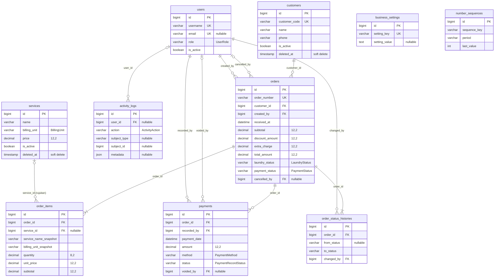
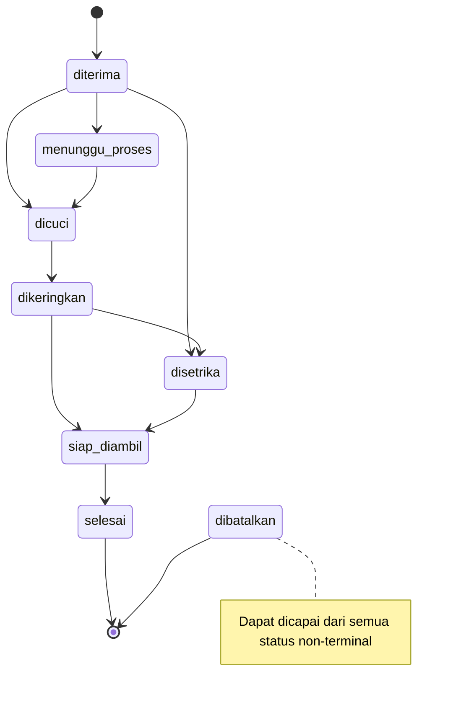

# DATABASE.md — Desain Skema Database LaundryDesk

**Status:** Disetujui (Task 2.1) · **Implementasi:** Task 2.2 (migration) dan Task 2.3 (model)
**Acuan:** `project/PRD.md` §5 dan §7, `project/ENGINEERING_STANDARDS.md` §5, `docs/IMPLEMENTATION_PLAN.md` §4
**Engine:** MariaDB 10.4 / MySQL (InnoDB) · **Charset:** `utf8mb4` / `utf8mb4_unicode_ci` · **Zona waktu aplikasi:** `Asia/Jakarta`

---

## 1. Konvensi

| Aspek | Aturan |
|---|---|
| Nama tabel | `snake_case`, jamak (`orders`, `order_items`) |
| Nama kolom | `snake_case`; FK `singular_id` atau peran aktor (`created_by`, `recorded_by`) |
| Primary key | `id` `BIGINT UNSIGNED AUTO_INCREMENT` |
| Uang | `DECIMAL(12,2)`, selalu bernilai rupiah bulat (`.00`) |
| Kuantitas | `DECIMAL(8,2)` |
| Status, role, metode, satuan | `VARCHAR(30)` berisi nilai PHP Backed Enum (`app/Enums`). **Tidak** memakai tipe MySQL `ENUM` |
| Waktu bisnis | `DATETIME` (`received_at`, `payment_date`, `cancelled_at`, dll.) |
| Waktu sistem | `created_at`, `updated_at` (`TIMESTAMP` bawaan Laravel) |
| `FLOAT` / `DOUBLE` | **Dilarang** di seluruh skema |
| Aritmetika PHP | `Brick\Math\BigDecimal` (dependensi bawaan Laravel). Model memakai cast `decimal:2` yang menghasilkan string |

---

## 2. Diagram Relasi (ERD)



`business_settings` dan `number_sequences` sengaja tidak memiliki relasi FK.

---

## 3. Kamus Data

Keterangan: **NN** = NOT NULL, **N** = NULLABLE.

### 3.1 `users` (modifikasi migration bawaan `0001_01_01_000000_create_users_table.php`)

| Kolom | Tipe | Null | Default | Keterangan |
|---|---|---|---|---|
| `id` | BIGINT UNSIGNED | NN | AI | PK |
| `name` | VARCHAR(100) | NN | | Nama tampilan |
| `username` | VARCHAR(50) | NN | | **Unique**, kredensial login utama |
| `email` | VARCHAR(255) | N | NULL | **Unique**, opsional (sistem offline tanpa email) |
| `password` | VARCHAR(255) | NN | | Hash Laravel (bcrypt) |
| `role` | VARCHAR(30) | NN | `kasir` | `UserRole` |
| `is_active` | BOOLEAN | NN | `true` | Akun nonaktif tidak bisa login |
| `remember_token` | VARCHAR(100) | N | NULL | |
| `created_at`, `updated_at` | TIMESTAMP | N | | |

Kolom `email_verified_at` dihapus. Tabel bawaan `password_reset_tokens` dan `sessions` tetap dipertahankan (sesi memakai driver database). `password_reset_tokens` tidak dipakai karena reset dilakukan via Artisan.

### 3.2 `customers`

| Kolom | Tipe | Null | Default | Keterangan |
|---|---|---|---|---|
| `id` | BIGINT UNSIGNED | NN | AI | PK |
| `customer_code` | VARCHAR(20) | NN | | **Unique**, `CUST-0001` dari `number_sequences` |
| `name` | VARCHAR(100) | NN | | |
| `phone` | VARCHAR(20) | NN | | Disimpan ternormalisasi (digit, awalan `08`/`62`) |
| `address` | TEXT | N | NULL | |
| `notes` | TEXT | N | NULL | |
| `is_active` | BOOLEAN | NN | `true` | |
| `created_at`, `updated_at` | TIMESTAMP | N | | |
| `deleted_at` | TIMESTAMP | N | NULL | Soft delete (arsip) |

### 3.3 `services`

| Kolom | Tipe | Null | Default | Keterangan |
|---|---|---|---|---|
| `id` | BIGINT UNSIGNED | NN | AI | PK |
| `name` | VARCHAR(100) | NN | | |
| `description` | TEXT | N | NULL | |
| `billing_unit` | VARCHAR(30) | NN | | `BillingUnit` (`kg`/`item`/`package`) |
| `price` | DECIMAL(12,2) | NN | | Rupiah bulat, `>= 0` |
| `estimated_hours` | SMALLINT UNSIGNED | N | NULL | Estimasi durasi pengerjaan |
| `is_active` | BOOLEAN | NN | `true` | Nonaktif = tidak bisa dipilih untuk pesanan baru |
| `created_at`, `updated_at` | TIMESTAMP | N | | |
| `deleted_at` | TIMESTAMP | N | NULL | Soft delete |

### 3.4 `number_sequences`

| Kolom | Tipe | Null | Default | Keterangan |
|---|---|---|---|---|
| `id` | BIGINT UNSIGNED | NN | AI | PK |
| `sequence_key` | VARCHAR(50) | NN | | `order` atau `customer` |
| `period` | VARCHAR(20) | NN | | `YYYYMMDD` untuk `order`, `all` untuk `customer` |
| `last_value` | INT UNSIGNED | NN | `0` | Nomor terakhir yang terpakai |
| `created_at`, `updated_at` | TIMESTAMP | N | | |

Unique: `(sequence_key, period)`.

### 3.5 `orders`

| Kolom | Tipe | Null | Default | Keterangan |
|---|---|---|---|---|
| `id` | BIGINT UNSIGNED | NN | AI | PK |
| `order_number` | VARCHAR(30) | NN | | **Unique**, `LD-YYYYMMDD-0001` |
| `customer_id` | BIGINT UNSIGNED | NN | | FK → `customers.id` |
| `created_by` | BIGINT UNSIGNED | NN | | FK → `users.id` (petugas penerima) |
| `received_at` | DATETIME | NN | | Tanggal/jam masuk; menentukan periode nomor transaksi |
| `estimated_completion_at` | DATETIME | N | NULL | |
| `completed_at` | DATETIME | N | NULL | Diisi saat status menjadi `selesai` |
| `subtotal` | DECIMAL(12,2) | NN | `0` | Σ `order_items.subtotal` |
| `discount_amount` | DECIMAL(12,2) | NN | `0` | `0 ≤ diskon ≤ subtotal` |
| `extra_charge` | DECIMAL(12,2) | NN | `0` | `>= 0` |
| `total_amount` | DECIMAL(12,2) | NN | `0` | `subtotal − discount_amount + extra_charge` |
| `notes` | TEXT | N | NULL | Catatan khusus |
| `laundry_status` | VARCHAR(30) | NN | `diterima` | `LaundryStatus` |
| `payment_status` | VARCHAR(30) | NN | `belum_dibayar` | `PaymentStatus` (cache, lihat §8) |
| `cancelled_at` | DATETIME | N | NULL | |
| `cancelled_by` | BIGINT UNSIGNED | N | NULL | FK → `users.id` |
| `cancellation_reason` | TEXT | N | NULL | Wajib saat dibatalkan |
| `created_at`, `updated_at` | TIMESTAMP | N | | |

### 3.6 `order_items`

| Kolom | Tipe | Null | Default | Keterangan |
|---|---|---|---|---|
| `id` | BIGINT UNSIGNED | NN | AI | PK |
| `order_id` | BIGINT UNSIGNED | NN | | FK → `orders.id` |
| `service_id` | BIGINT UNSIGNED | N | NULL | FK → `services.id` (rujukan saja) |
| `service_name_snapshot` | VARCHAR(100) | NN | | Snapshot `services.name` |
| `billing_unit_snapshot` | VARCHAR(30) | NN | | Snapshot `services.billing_unit` |
| `quantity` | DECIMAL(8,2) | NN | | `> 0`; bilangan bulat jika satuan bukan `kg` |
| `unit_price` | DECIMAL(12,2) | NN | | Snapshot `services.price` |
| `subtotal` | DECIMAL(12,2) | NN | | `round_half_up(quantity × unit_price, 0)` |
| `notes` | VARCHAR(255) | N | NULL | |
| `created_at`, `updated_at` | TIMESTAMP | N | | |

### 3.7 `payments`

| Kolom | Tipe | Null | Default | Keterangan |
|---|---|---|---|---|
| `id` | BIGINT UNSIGNED | NN | AI | PK |
| `order_id` | BIGINT UNSIGNED | NN | | FK → `orders.id` |
| `recorded_by` | BIGINT UNSIGNED | NN | | FK → `users.id` |
| `payment_date` | DATETIME | NN | | Tanggal uang diterima; dasar laporan kas masuk |
| `amount` | DECIMAL(12,2) | NN | | Rupiah bulat, `> 0`, tidak boleh melebihi sisa tagihan |
| `method` | VARCHAR(30) | NN | | `PaymentMethod` |
| `cash_tendered` | DECIMAL(12,2) | N | NULL | Uang fisik diterima pelanggan (khusus `tunai`), `>= amount` |
| `change_amount` | DECIMAL(12,2) | N | NULL | Uang kembalian ke pelanggan (`cash_tendered - amount`), `>= 0` |
| `reference` | VARCHAR(100) | N | NULL | No. referensi transfer/QRIS |
| `notes` | VARCHAR(255) | N | NULL | |
| `status` | VARCHAR(30) | NN | `valid` | `PaymentRecordStatus` |
| `voided_by` | BIGINT UNSIGNED | N | NULL | FK → `users.id` |
| `voided_at` | DATETIME | N | NULL | |
| `void_reason` | TEXT | N | NULL | Wajib saat void |
| `created_at`, `updated_at` | TIMESTAMP | N | | |

Nominal pembayaran **tidak pernah diedit**. Koreksi hanya melalui void lalu pencatatan pembayaran baru. CHECK constraint database memastikan `cash_tendered >= amount` dan `change_amount >= 0` ketika diisi.

### 3.8 `order_status_histories`

| Kolom | Tipe | Null | Default | Keterangan |
|---|---|---|---|---|
| `id` | BIGINT UNSIGNED | NN | AI | PK |
| `order_id` | BIGINT UNSIGNED | NN | | FK → `orders.id` |
| `from_status` | VARCHAR(30) | N | NULL | NULL pada entri pertama (pesanan dibuat) |
| `to_status` | VARCHAR(30) | NN | | `LaundryStatus` |
| `changed_by` | BIGINT UNSIGNED | NN | | FK → `users.id` |
| `note` | TEXT | N | NULL | Untuk pembatalan berisi alasan |
| `created_at`, `updated_at` | TIMESTAMP | N | | `created_at` = waktu perubahan |

### 3.9 `business_settings`

| Kolom | Tipe | Null | Default | Keterangan |
|---|---|---|---|---|
| `id` | BIGINT UNSIGNED | NN | AI | PK |
| `setting_key` | VARCHAR(100) | NN | | **Unique** (lihat §13) |
| `setting_value` | TEXT | N | NULL | |
| `created_at`, `updated_at` | TIMESTAMP | N | | |

### 3.10 `activity_logs`

| Kolom | Tipe | Null | Default | Keterangan |
|---|---|---|---|---|
| `id` | BIGINT UNSIGNED | NN | AI | PK |
| `user_id` | BIGINT UNSIGNED | N | NULL | FK → `users.id` (aktor) |
| `action` | VARCHAR(50) | NN | | `ActivityAction` |
| `subject_type` | VARCHAR(255) | N | NULL | Kelas model terkait (morph) |
| `subject_id` | BIGINT UNSIGNED | N | NULL | |
| `description` | TEXT | N | NULL | Ringkasan berbahasa Indonesia |
| `metadata` | JSON | N | NULL | Nilai lama/baru. **Dilarang** berisi password/token |
| `created_at`, `updated_at` | TIMESTAMP | N | | |

---

## 4. Foreign Key dan Aturan Penghapusan

| FK | Null | On delete | Alasan |
|---|---|---|---|
| `orders.customer_id → customers.id` | ✗ | `RESTRICT` | Pelanggan diarsipkan (soft delete), tidak dihapus fisik |
| `orders.created_by → users.id` | ✗ | `RESTRICT` | User dinonaktifkan, tidak dihapus |
| `orders.cancelled_by → users.id` | ✓ | `RESTRICT` | Jejak aktor pembatalan |
| `order_items.order_id → orders.id` | ✗ | `RESTRICT` | Transaksi tidak boleh dihapus |
| `order_items.service_id → services.id` | ✓ | `SET NULL` | Snapshot tetap utuh walau layanan terhapus |
| `payments.order_id → orders.id` | ✗ | `RESTRICT` | |
| `payments.recorded_by → users.id` | ✗ | `RESTRICT` | |
| `payments.voided_by → users.id` | ✓ | `RESTRICT` | |
| `order_status_histories.order_id → orders.id` | ✗ | `RESTRICT` | |
| `order_status_histories.changed_by → users.id` | ✗ | `RESTRICT` | |
| `activity_logs.user_id → users.id` | ✓ | `SET NULL` | Log harus bertahan |

Semua FK memakai `ON UPDATE RESTRICT` (default).

### Kebijakan retensi

| Tabel | Kebijakan |
|---|---|
| `customers`, `services` | `SoftDeletes` + `is_active` |
| `users` | `is_active` saja |
| `orders` | Tidak dihapus; batal = `laundry_status = dibatalkan` |
| `payments` | Tidak dihapus; koreksi = void |
| `order_items`, `order_status_histories`, `activity_logs`, `number_sequences` | Tidak dihapus |

---

## 5. Unique, Index, dan CHECK Constraint

### 5.1 Unique & index

| Tabel | Unique | Index |
|---|---|---|
| `users` | `username`, `email` | `(role, is_active)` |
| `customers` | `customer_code` | `phone`, `name`, `is_active` |
| `services` | — | `(is_active, name)` |
| `number_sequences` | `(sequence_key, period)` | — |
| `orders` | `order_number` | `received_at`, `laundry_status`, `payment_status`, `customer_id`, `created_by` |
| `order_items` | — | `order_id`, `service_id` |
| `payments` | — | `(order_id, status)`, `(status, payment_date)`, `method`, `recorded_by` |
| `order_status_histories` | — | `(order_id, created_at)` |
| `business_settings` | `setting_key` | — |
| `activity_logs` | — | `user_id`, `action`, `(subject_type, subject_id)`, `created_at` |

- `customers.phone` dan `services.name` **tidak** unique di DB karena akan bentrok dengan data yang diarsipkan. Keunikan dicek di Form Request terhadap data yang belum diarsipkan.
- Pencarian pesanan berdasarkan nama/telepon pelanggan memakai `JOIN customers`. Pencarian awalan (`LIKE 'x%'`) memakai index; pencarian tengah (`LIKE '%x%'`) melakukan full scan, yang masih dapat diterima untuk volume UKM.

### 5.2 CHECK constraint (pertahanan lapis kedua)

Ditambahkan lewat `DB::statement` di migration, hanya untuk driver `mysql`/`mariadb` (MariaDB ≥ 10.2 menegakkan CHECK):

| Tabel | Constraint |
|---|---|
| `services` | `chk_services_price`: `price >= 0` |
| `orders` | `chk_orders_amounts`: `discount_amount >= 0 AND extra_charge >= 0 AND total_amount >= 0` |
| `order_items` | `chk_order_items_values`: `quantity > 0 AND unit_price >= 0 AND subtotal >= 0` |
| `payments` | `chk_payments_amount`: `amount > 0` |

Validasi utama tetap di Form Request dan Service; CHECK hanya penahan terakhir.

---

## 6. Enum Terpusat (`app/Enums/`)

| Enum | Nilai DB → Label |
|---|---|
| `UserRole` | `admin` → Admin · `kasir` → Kasir |
| `BillingUnit` | `kg` → Kg · `item` → Item · `package` → Paket |
| `LaundryStatus` | `diterima` → Diterima · `menunggu_proses` → Menunggu Proses · `dicuci` → Dicuci · `dikeringkan` → Dikeringkan · `disetrika` → Disetrika · `siap_diambil` → Siap Diambil · `selesai` → Selesai/Diambil · `dibatalkan` → Dibatalkan |
| `PaymentStatus` | `belum_dibayar` → Belum Dibayar · `dibayar_sebagian` → Dibayar Sebagian · `lunas` → Lunas |
| `PaymentMethod` | `tunai` → Tunai · `transfer_bank` → Transfer Bank · `qris_manual` → QRIS (Manual) · `lainnya` → Lainnya |
| `PaymentRecordStatus` | `valid` → Valid · `voided` → Dibatalkan (Void) |
| `ActivityAction` | `auth.login`, `auth.logout`, `order.created`, `order.status_changed`, `order.cancelled`, `payment.recorded`, `payment.voided`, `service.price_changed`, `setting.updated` |

Kode aplikasi **wajib** merujuk ke case enum (mis. `LaundryStatus::Dicuci`), tidak menulis string lepas. Model memakai cast enum di Task 2.3.

---

## 7. Transisi Status Cucian

Sumber kebenaran: `LaundryStatus::allowedTransitions()`.



Diagram hanya menampilkan jalur utama. Matriks lengkapnya:

| Dari | Ke yang diizinkan |
|---|---|
| `diterima` | `menunggu_proses`, `dicuci`, `dikeringkan`, `disetrika`, `siap_diambil`, `dibatalkan` |
| `menunggu_proses` | `dicuci`, `dikeringkan`, `disetrika`, `siap_diambil`, `dibatalkan` |
| `dicuci` | `dikeringkan`, `disetrika`, `siap_diambil`, `dibatalkan` |
| `dikeringkan` | `disetrika`, `siap_diambil`, `dibatalkan` |
| `disetrika` | `siap_diambil`, `dibatalkan` |
| `siap_diambil` | `selesai`, `dibatalkan` |
| `selesai` | — (terminal) |
| `dibatalkan` | — (terminal) |

Aturan:
1. Maju boleh melompati tahap yang tidak relevan (mis. "Setrika Saja": `diterima → disetrika`).
2. `selesai` hanya sah dari `siap_diambil` (serah terima fisik).
3. Setiap perubahan menulis satu baris `order_status_histories`. Pembuatan pesanan menulis entri awal `NULL → diterima`.
4. Transisi ke `selesai` mengisi `orders.completed_at`.
5. Transisi ke `dibatalkan` mensyaratkan **tidak ada pembayaran valid** (§12).
6. Koreksi mundur dan izin per role diatur di Fase 3/7 (Policy), bukan di skema.

---

## 8. Status Pembayaran dan Saldo

```
paid           = SUM(payments.amount) WHERE order_id = ? AND status = 'valid'
sisa_tagihan   = orders.total_amount − paid

PaymentStatus::fromAmounts(total, paid):
  paid >= total      → lunas            (termasuk total = 0 karena diskon penuh)
  paid = 0           → belum_dibayar
  0 < paid < total   → dibayar_sebagian
```

- `sisa_tagihan` **tidak disimpan**; dihitung via agregat (`withSum`) agar hanya ada satu sumber kebenaran.
- `orders.payment_status` adalah cache untuk filter/index. Nilainya diperbarui di dalam `DB::transaction` yang sama dengan insert atau void pembayaran, dengan `lockForUpdate()` pada baris order.
- Invarian: `paid ≤ total_amount`. Pembayaran yang melebihi sisa tagihan ditolak.
- Status cucian dan status pembayaran independen: `siap_diambil` belum tentu `lunas`, dan `lunas` belum tentu `selesai`.

### Definisi angka laporan

| Istilah | Sumber |
|---|---|
| Nilai transaksi | `SUM(orders.total_amount)` per `received_at`, tanpa `dibatalkan` |
| Uang diterima (kas masuk) | `SUM(payments.amount)` per `payment_date`, `status = valid` |
| Sisa tagihan / piutang | `total_amount − paid` untuk order yang tidak `dibatalkan` |

---

## 9. Perhitungan Uang dan Pembulatan

```
item.subtotal   = round_half_up(quantity × unit_price, 0)
order.subtotal  = Σ item.subtotal
order.total     = order.subtotal − discount_amount + extra_charge
```

| Aturan | Keterangan |
|---|---|
| Nilai bulat | `price`, `discount_amount`, `extra_charge`, dan `payments.amount` wajib rupiah bulat (divalidasi di Form Request) |
| Pembulatan per item | Half-up ke rupiah penuh. Contoh: 2,33 kg × Rp7.250 = Rp16.892,50 → **Rp16.893** |
| Alasan per item | Jumlah baris nota selalu sama persis dengan subtotal pesanan |
| Diskon | `0 ≤ discount_amount ≤ order.subtotal`, sehingga `total ≥ 0` |
| Dihitung di server | Harga dan total dari browser diabaikan; `unit_price` selalu diambil dari DB |
| Tanpa float | Semua aritmetika memakai `BigDecimal` (`toScale(0, RoundingMode::HalfUp)`) |

---

## 10. Snapshot Layanan pada `order_items`

| Kolom | Diisi dari | Berubah jika master diubah? |
|---|---|---|
| `service_id` | `services.id` | Bisa menjadi NULL (hanya rujukan) |
| `service_name_snapshot` | `services.name` | **Tidak** |
| `billing_unit_snapshot` | `services.billing_unit` | **Tidak** |
| `unit_price` | `services.price` | **Tidak** |
| `subtotal` | Dihitung server | **Tidak** |

- Nota, detail pesanan, laporan, dan riwayat **hanya** membaca kolom snapshot, tidak pernah `services.*`.
- Layanan nonaktif atau terarsip tidak bisa dipilih untuk pesanan baru, tetapi pesanan lama tetap terbaca utuh.
- Data pelanggan **tidak** di-snapshot (keputusan Q4): nota menampilkan nama/telepon pelanggan terkini.

---

## 11. Penomoran: `number_sequences`

| Kebutuhan | `sequence_key` | `period` | Format |
|---|---|---|---|
| Nomor transaksi | `order` | `YYYYMMDD` dari `received_at` | `{order_number_prefix}-YYYYMMDD-0001` |
| Kode pelanggan | `customer` | `all` | `CUST-0001` |

**Algoritma** (`NumberSequenceService::next($key, $period)`, Fase 5/6), dijalankan **di dalam** `DB::transaction` milik pemanggil:
1. `insertOrIgnore` baris `(key, period, last_value = 0)` agar baris pasti ada.
2. `SELECT … WHERE sequence_key = ? AND period = ? FOR UPDATE` untuk mengunci baris nyata, sehingga tidak ada *gap lock*.
3. `last_value = last_value + 1`, simpan, kembalikan nilainya.

Sifat:
- Kasir lain menunggu sampai transaksi selesai, jadi nomor tidak pernah ganda.
- Jika penyimpanan pesanan gagal, counter ikut di-rollback sehingga nomor tidak loncat.
- Padding 4 digit dan bertambah panjang otomatis setelah 9999.
- Unique index `orders.order_number` dan `customers.customer_code` tetap menjadi pengaman terakhir.

---

## 12. Pembatalan Pesanan dan Void Pembayaran

**Pembatalan pesanan** (`OrderService`, Fase 7):
1. Ditolak jika masih ada pembayaran `valid` (keputusan Q3). Admin harus void setiap pembayaran lebih dulu.
2. Status saat ini harus mengizinkan transisi ke `dibatalkan`.
3. Dalam satu transaksi: set `laundry_status = dibatalkan`, `cancelled_at`, `cancelled_by`, `cancellation_reason`, tulis `order_status_histories`, dan tulis `activity_logs` (`order.cancelled`).
4. Pesanan `dibatalkan` tidak dapat menerima pembayaran baru.

**Void pembayaran** (`PaymentService`, Fase 8):
1. Hanya role berwenang (Admin).
2. Set `status = voided`, `voided_by`, `voided_at`, `void_reason`; nominal tidak diubah.
3. Hitung ulang `orders.payment_status` dalam transaksi yang sama.
4. Tulis `activity_logs` (`payment.voided`).

Batasan v1: pesanan tidak bisa dibatalkan sambil menahan DP sebagai biaya pembatalan.

---

## 13. Kunci `business_settings`

| `setting_key` | Contoh nilai | Keterangan |
|---|---|---|
| `business_name` | `RAP Laundry` | Tampil di nota dan login |
| `business_address` | | |
| `business_phone` | | |
| `business_logo_path` | NULL | Path relatif storage publik |
| `order_number_prefix` | `LD` | Awalan nomor transaksi |
| `receipt_footer_note` | | Catatan pengambilan di nota |
| `default_estimated_hours` | `48` | Default estimasi selesai |
| `print_format` | `a4` | `a4` / `thermal_58` / `thermal_80` |
| `operating_hours` | `08.00–20.00` | Opsional |

Kunci didaftarkan sebagai konstanta di model `BusinessSetting` (Task 2.3) dan diisi oleh seeder.

---

## 14. Invarian Integritas (dijaga Service Layer)

1. `order.subtotal = Σ order_items.subtotal`, dan `order.total_amount = subtotal − discount_amount + extra_charge`.
2. `order.payment_status = PaymentStatus::fromAmounts(total_amount, paid)`.
3. `Σ payments valid ≤ order.total_amount`.
4. `laundry_status = dibatalkan` ⇔ `cancelled_at`, `cancelled_by`, dan `cancellation_reason` terisi.
5. `laundry_status = selesai` ⇔ `completed_at` terisi.
6. `payments.status = voided` ⇔ `voided_by`, `voided_at`, dan `void_reason` terisi.
7. Setiap pesanan memiliki minimal satu `order_items` dan satu `order_status_histories`.

---

## 15. Urutan Migration (Task 2.2)

| # | Migration | Bergantung pada |
|---|---|---|
| 1 | `0001_01_01_000000_create_users_table.php` (modifikasi) | — |
| 2 | `create_customers_table` | — |
| 3 | `create_services_table` | — |
| 4 | `create_number_sequences_table` | — |
| 5 | `create_orders_table` | users, customers |
| 6 | `create_order_items_table` | orders, services |
| 7 | `create_payments_table` | orders, users |
| 8 | `create_order_status_histories_table` | orders, users |
| 9 | `create_business_settings_table` | — |
| 10 | `create_activity_logs_table` | users |

Migration bawaan `cache` dan `jobs` tetap dipertahankan.

> [!WARNING]
> `phpunit.xml` saat ini tidak mengatur database test, sehingga test berjalan pada DB dev `rap_laundry` dan `RefreshDatabase` akan **menghapus datanya**. Sebelum test pertama (Task 2.2), buat DB `rap_laundry_testing` lewat phpMyAdmin lalu tambahkan `<env name="DB_DATABASE" value="rap_laundry_testing"/>` di `phpunit.xml`.

---

## 16. Keputusan Desain, Asumsi, dan Keterbatasan

### Keputusan (disetujui pada Task 2.1)

| # | Keputusan |
|---|---|
| Q1 | Subtotal per item dibulatkan half-up ke rupiah penuh; semua nominal bernilai bulat |
| Q2 | Tabel `number_sequences` dengan row lock untuk nomor transaksi dan kode pelanggan |
| Q3 | Pembatalan ditolak selama masih ada pembayaran valid; admin harus void terlebih dahulu |
| Q4 | Tidak ada snapshot data pelanggan di `orders` |
| — | Kolom status memakai `VARCHAR(30)` + PHP Backed Enum, bukan MySQL `ENUM` |
| — | Sisa tagihan tidak disimpan; `payment_status` disimpan sebagai cache |

### Perbedaan dari PRD §7

| Tabel | Perubahan |
|---|---|
| `users` | `+ username` (unique), `email` nullable, `− email_verified_at` |
| `orders` | `+ cancelled_by` |
| `payments` | `+ void_reason` |
| `number_sequences` | Tabel tambahan |

### Asumsi
- Satu cabang usaha, satu database.
- Mata uang tunggal Rupiah tanpa pajak (PPN) di v1.
- Volume data skala UKM (puluhan ribu pesanan per tahun).

### Keterbatasan
- Refund parsial dan pembatalan sambil menahan DP tidak didukung di v1.
- Metode pembayaran bersifat tetap (enum) dan "metode lain" dicatat sebagai `lainnya` + `reference`.
- Pencarian teks di tengah kata (`LIKE '%x%'`) tidak memakai index.
- `brick/math` dipakai sebagai dependensi transitif Laravel; disarankan dideklarasikan eksplisit di `composer.json` jika kebijakan dependensi mengizinkan.
