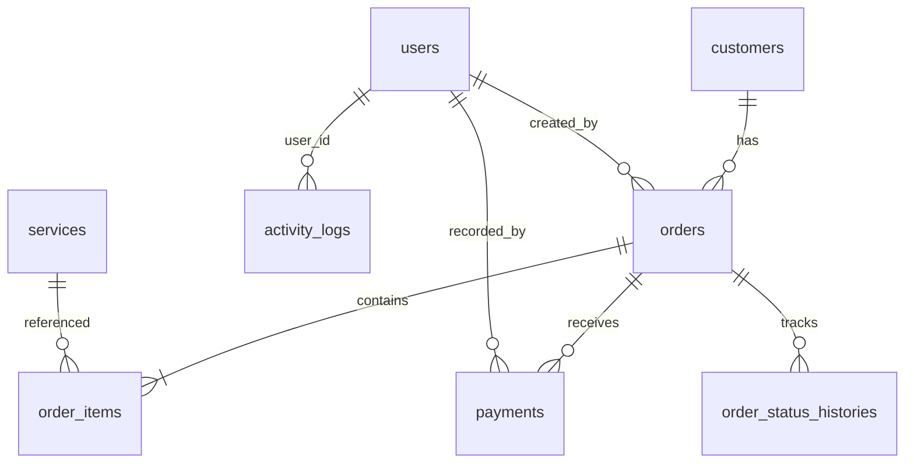

# Rencana Implementasi Teknis (Technical Implementation Plan)

**Proyek:** LaundryDesk (RAP Laundry)  
**Dokumen Acuan:** `project/PRD.md`, `project/TASK.md`, `project/ENGINEERING_STANDARDS.md`  
**Framework:** Laravel 12 (PHP 8.2+)  
**Database:** MariaDB 10.4 / MySQL (XAMPP Lokal)  
**Pola Desain:** Clean MVC + Service Layer + Form Request + Backed PHP Enum  
**Status Dokumen:** Baseline Disetujui (Approved Baseline)  

---

## 1. Ringkasan Eksekutif & Sasaran Teknis

LaundryDesk adalah sistem website pengelolaan operasional cucian pakaian berbasis komputer lokal (*offline-first*) yang ditujukan untuk skala usaha kecil hingga menengah. Aplikasi ini dirancang agar kasir dan pemilik usaha dapat melakukan pencatatan transaksi secara cepat, akurat, dan aman tanpa ketergantungan pada koneksi internet.

### Prinsip Utama Rekayasa:
`Correctness > Security > Financial Integrity > Maintainability > Readability > Aesthetics`

---

## 2. Asumsi Teknis, Risiko, Dependensi & Konfirmasi Desain

### 2.1 Asumsi Teknis
1. **Lingkungan Host:** Sistem beroperasi pada server lokal XAMPP Windows (Apache port 80/8000, MariaDB port 3306, PHP 8.2.12).
2. **Jaringan:** Fitur inti 100% luring (*offline*). Akses multi-perangkat dimungkinkan melalui jaringan lokal (LAN/Wi-Fi) menggunakan IP komputer server tanpa memerlukan koneksi internet.
3. **Autentikasi Internal:** Tidak ada registrasi mandiri untuk publik. Seluruh akun (Admin dan Kasir) dibuat oleh Administrator atau melalui database seeding awal.
4. **Pembayaran Manual:** Transaksi tunai, QRIS statis, atau transfer bank diverifikasi secara kasat mata oleh kasir; tidak ada webhook atau payment gateway pihak ketiga.

### 2.2 Risiko Teknis & Strategi Mitigasi

| Risiko | Dampak | Strategi Mitigasi |
| :--- | :--- | :--- |
| **Duplikasi Nomor Transaksi (`LD-YYYYMMDD-0001`) saat konkurensi kasir bersamaan** | Kerusakan integritas data & komplain nota ganda | Gunakan nomor urut terisolasi dengan locking database (`pessimistic locking` / `SELECT FOR UPDATE` pada tabel urutan atau counter berbasis tanggal) dalam Database Transaction. |
| **Ketidaktepatan kalkulasi uang akibat floating-point precision** | Selisih pembukuan kas (*rounding errors*) | Gunakan tipe data `DECIMAL(12,2)` di MySQL dan `bcmath` / integer cent di PHP. Dilarang menggunakan tipe `FLOAT` / `DOUBLE`. |
| **Perubahan harga master layanan merusak nota lama** | Riwayat transaksi historis berubah | Snapshot harga satuan (`unit_price`), nama layanan (`service_name_snapshot`), dan satuan (`billing_unit_snapshot`) langsung di tabel `order_items` saat transaksi dibuat. |
| **Aset frontend gagal dimuat saat internet mati** | Kerusakan tampilan kasir | Nol dependensi CDN, font eksternal, atau script online. Seluruh CSS, JavaScript, font WOFF2, dan ikon SVG disimpan statis di direktori `public/`. |
| **PowerShell script execution policy pada Windows** | Build npm terblokir | Gunakan eksekusi `npm.cmd` eksplisit atau kompilasi aset sekali ke `public/`, memastikan aplikasi produksi berjalan tanpa dev-server. |

### 2.3 Dependensi Eksternal & Pustaka Pilihan
- **PHP 8.2+ & Laravel 12:** Framework inti.
- **Vanilla CSS + Glassmorphism Tokens:** Styling ringan tanpa dependensi runtime pihak ketiga yang berat.
- **Vanilla JS:** Interaktivitas form pesanan, kalkulator instan kasir, dan dialog konfirmasi.
- **Ikon:** SVG murni *inline* atau disimpan secara lokal di `public/icons/`.

---

## 3. Arsitektur Perangkat Lunak & Struktur Kode

Aplikasi mengadopsi arsitektur Laravel yang terstruktur rapi untuk menjaga kode tetap ringkas, mudah dibaca, dan minim beban kognitif:

```text
app/
├── Enums/
│   ├── LaundryStatus.php         # Diterima, Menunggu, Dicuci, Dikeringkan, Disetrika, Siap Diambil, Selesai, Dibatalkan
│   ├── PaymentStatus.php         # Belum Dibayar, Dibayar Sebagian, Lunas
│   ├── PaymentMethod.php         # Tunai, Transfer Bank, QRIS
│   ├── BillingUnit.php           # Kg, Item, Paket
│   └── UserRole.php              # Admin, Kasir
├── Http/
│   ├── Controllers/              # Penanganan Request & Response (Tipis, delegasi ke Service)
│   ├── Requests/                 # Form Request Validation (Ketat, pesan bahasa Indonesia)
│   └── Middleware/               # Proteksi Role Admin & Kasir Aktif
├── Models/                       # Eloquent Models & Relasi Data
├── Services/
│   ├── OrderService.php          # Logika pembuatan order, kalkulasi subtotal, diskon, extra charge
│   ├── PaymentService.php        # Pencatatan pembayaran, validasi overpay, update payment_status
│   ├── OrderNumberService.php    # Generator nomor transaksi unik dan anti-tabrakan
│   └── AuditService.php          # Pencatatan riwayat aktivitas pengguna
└── Policies/                     # Otorisasi hak akses Admin vs Kasir
```

---

## 4. Desain Database & Urutan Migrasi

Untuk menjaga integritas referensial dan foreign key constraint, urutan migration ditetapkan secara ketat:



### Urutan Migration:
1. `0001_01_01_000000_create_users_table.php` (ditambah kolom `username`, `role`, `is_active`)
2. `create_customers_table.php` (`id`, `customer_code`, `name`, `phone`, `address`, `notes`, `is_active`, timestamps, soft deletes)
3. `create_services_table.php` (`id`, `name`, `description`, `billing_unit`, `price`, `estimated_hours`, `is_active`, timestamps, soft deletes)
4. `create_orders_table.php` (`id`, `order_number` [unique], `customer_id`, `created_by`, `received_at`, `estimated_completion_at`, `completed_at`, `subtotal`, `discount_amount`, `extra_charge`, `total_amount`, `laundry_status`, `payment_status`, `notes`, `cancelled_at`, `cancellation_reason`, timestamps)
5. `create_order_items_table.php` (`id`, `order_id`, `service_id`, `service_name_snapshot`, `billing_unit_snapshot`, `quantity`, `unit_price`, `subtotal`, `notes`, timestamps)
6. `create_payments_table.php` (`id`, `order_id`, `recorded_by`, `payment_date`, `amount`, `method`, `reference`, `notes`, `status`, `voided_by`, `voided_at`, timestamps)
7. `create_order_status_histories_table.php` (`id`, `order_id`, `from_status`, `to_status`, `changed_by`, `note`, timestamps)
8. `create_business_settings_table.php` (`id`, `setting_key` [unique], `setting_value`, timestamps)
9. `create_activity_logs_table.php` (`id`, `user_id`, `action`, `subject_type`, `subject_id`, `description`, `metadata`, timestamps)

---

## 5. Rencana Tahapan Implementasi (Roadmap)

### Fase 1 — Fondasi Laravel & Aset Offline (Sedang Berjalan)
- **Task 1.1:** Penyusunan dokumen teknis `docs/IMPLEMENTATION_PLAN.md` (Tahap ini).
- **Task 1.2:** Inisialisasi proyek Laravel 12 pada workspace lokal, konfigurasi `.env`, verifikasi booting.
- **Task 1.3:** Setup struktur aset statis offline (CSS, JS, Ikon lokal), konfigurasi fallback glassmorphism.
- *Gate 1:* Aplikasi Laravel dapat diakses di `localhost` tanpa dependensi eksternal.

### Fase 2 — Skema Database, Model & Domain Layer
- **Task 2.1:** Implementasi PHP Enums (`LaundryStatus`, `PaymentStatus`, dll).
- **Task 2.2:** Pembuatan migration untuk 9 tabel inti dengan indeks dan foreign keys.
- **Task 2.3:** Implementasi Eloquent Models, casting nilai, dan relasi integritas.
- **Task 2.4:** Pembuatan Seeder awal: Akun Admin & Kasir default, Master Layanan Laundry, Pengaturan Usaha.
- *Gate 2:* `php artisan migrate --seed` berhasil dijalankan tanpa error di MariaDB lokal.

### Fase 3 — Sistem Desain Glassmorphism & Layout Responsif
- **Task 3.1:** Design token CSS (palet biru-putih, radius, efek blur kartu kaca, fallback solid).
- **Task 3.2:** Master layout Blade (Sidebar navigasi, Topbar profil, area konten, footer status).
- **Task 3.3:** Komponen UI reusable (Button, Badge status, Form Input, Table wrapper, Alert, Modal konfirmasi).
- *Gate 3:* UI responsif, kontras terbaca jelas, dan berfungsi offline.

### Fase 4 — Autentikasi & Manajemen Pengguna
- **Task 4.1:** Autentikasi sesi berbasis cookie aman (Login/Logout) dengan pesan berbahasa Indonesia.
- **Task 4.2:** Middleware otorisasi `RoleMiddleware` dan pembatasan akses hak Admin vs Kasir.
- **Task 4.3:** CRUD Pengguna (khusus hak Admin).
- *Gate 4:* Kasir tidak dapat mengakses rute manajemen pengguna maupun setting kritis.

### Fase 5 — Master Data: Pelanggan & Layanan
- **Task 5.1:** Modul Pelanggan (Pencarian cepat nama/telepon, auto-generate kode pelanggan, validasi nomor).
- **Task 5.2:** Modul Master Layanan & Harga (Kelola tarif per kg/item, durasi estimasi, switch aktif/nonaktif).
- *Gate 5:* Pelanggan dan layanan dapat dikelola dengan proteksi penghapusan data bersejarah (soft delete).

### Fase 6 — Transaksi Laundry & Operasional Kasir
- **Task 6.1:** `OrderNumberService` untuk pembuatan nomor transaksi unik (`LD-YYYYMMDD-0001`) aman konkurensi.
- **Task 6.2:** Form pembuatan order responsif (tambah baris layanan dinamis, kalkulator live subtotal).
- **Task 6.3:** `OrderService` di backend: validasi ketat server-side, kalkulasi diskon/biaya tambahan, penyimpanan via Database Transaction.
- *Gate 6:* Transaksi tersimpan dengan snapshot harga dan nomor unik tanpa potensi duplikasi.

### Fase 7 — Manajemen Status Cucian & Audit Riwayat
- **Task 7.1:** Transisi alur status: `Diterima` ➔ `Menunggu Proses` ➔ `Dicuci` ➔ `Dikeringkan` ➔ `Disetrika` ➔ `Siap Diambil` ➔ `Selesai`.
- **Task 7.2:** Opsi pembatalan transaksi dengan kewajiban mengisi alasan pembatalan.
- **Task 7.3:** Pencatatan otomatis ke tabel `order_status_histories` dengan pencatatan waktu dan aktor.
- *Gate 7:* Setiap perubahan status tercatat dalam timeline detail pesanan.

### Fase 8 — Pembayaran Manual & Nota Cetak Ramah Kertas
- **Task 8.1:** Modul pencatatan pembayaran (DP, pelunasan bertahap, pemilihan metode manual).
- **Task 8.2:** Validasi batas pembayaran (mencegah kelebihan bayar) dan kalkulasi otomatis sisa tagihan.
- **Task 8.3:** Layout nota transaksi siap cetak (`@media print`) untuk ukuran nota thermal 58mm/80mm dan kertas A4.
- *Gate 8:* Nota tercetak rapi tanpa header/footer peramban yang mengganggu; pembayaran tercatat akurat.

### Fase 9 — Dashboard Operasional, Laporan & Pengaturan Usaha
- **Task 9.1:** Dashboard statistik harian (order masuk, cucian siap diambil, kas riil masuk, total piutang).
- **Task 9.2:** Laporan transaksi & pendapatan berbasis tanggal pembayaran valid dengan ekspor CSV.
- **Task 9.3:** Modul pengaturan identitas usaha (nama laundry, alamat, nomor telepon, footer nota).
- *Gate 9:* Data keuangan dashboard dan laporan sinkron dengan transaksi nyata di database.

### Fase 10 — QA, Pengujian Otomatis, & Dokumentasi Rilis
- **Task 10.1:** Pembuatan Automated Feature Tests (Login, Kalkulasi Order, Validasi Uang, Otorisasi).
- **Task 10.2:** Uji skenario operasional luring tanpa koneksi internet.
- **Task 10.3:** Penyusunan panduan instalasi lengkap di `README.md`.
- *Gate 10:* Seluruh automated test lolos, checklist `TASK.md` lengkap, dan aplikasi siap rilis lokal.

---

## 6. Definisi Selesai (Definition of Done) Tiap Gate

Sebuah fase dinyatakan selesai jika dan hanya jika:
1. Kode sumber telah ditulis sesuai kaidah `ENGINEERING_STANDARDS.md`.
2. Migrasi dan seeding database telah diverifikasi secara riil pada MariaDB lokal.
3. Alur fitur telah diuji baik melalui automated test maupun pengetesan langsung di browser.
4. Tidak ada regresi atau error pada log sistem (`storage/logs/laravel.log`).
5. Status checklist pada `project/TASK.md` telah diperbarui secara faktual.
