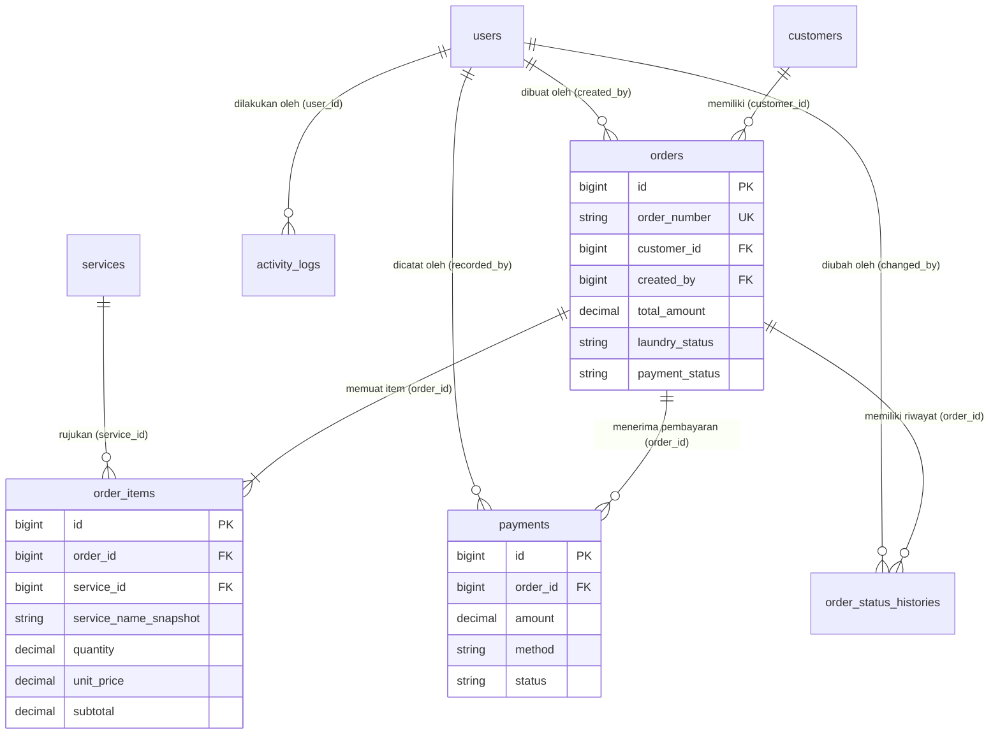
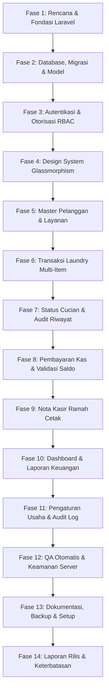

# Rencana Implementasi Teknis (Technical Implementation Plan)
## LaundryDesk — Sistem Pengelolaan Cuci Pakaian Offline

**Proyek:** LaundryDesk (RAP Laundry)  
**Dokumen Acuan:** `project/PRD.md`, `project/TASK.md`, `project/ENGINEERING_STANDARDS.md`, `docs/ENVIRONMENT_AUDIT.md`, `docs/BACKUP_RESTORE.md`  
**Framework:** Laravel 12 (PHP 8.2.12+)  
**Database:** MariaDB 10.4.32 / MySQL (XAMPP Port 3306 Lokal, phpMyAdmin)  
**Pola Desain:** Clean MVC + Service Layer + Form Request + Policies + Backed PHP Enum  
**Gaya Desain:** Glassmorphism Elegan (Palet Biru & Putih) — 100% Offline-First  
**Status Gate:** Gate 0 Lulus | Gate 1 Lulus | Gate 2 Lulus (Fase 2 Selesai) — Siap Lanjut ke Fase 3  

---

## 1. Ringkasan Eksekutif & Sasaran Teknis

LaundryDesk adalah aplikasi web operasional pengelolaan cuci pakaian luring (*offline-first*) yang ditujukan untuk usaha laundry pakaian skala kecil hingga menengah. Sistem ini mengonsolidasikan pencatatan pelanggan, pembuatan order transaksi multi-layanan, kalkulasi otomatis berbasis kuantitas riil/desimal (kg/item), pelacakan progres cucian, pencatatan kas pembayaran bertahap (DP dan pelunasan), pencetakan nota ramah printer, hingga pelaporan keuangan kas masuk harian.

### Prinsip Utama Rekayasa:
$$\text{Correctness} > \text{Security} > \text{Financial Integrity} > \text{Maintainability} > \text{Readability} > \text{Aesthetics}$$

Aplikasi dibangun untuk beroperasi secara mandiri di komputer lokal (atau diakses via LAN Wi-Fi lokal antar perangkat kasir) tanpa ketergantungan pada koneksi internet publik setelah proses instalasi dependensi dan kompilasi aset selesai.

---

## 2. Asumsi Teknis, Risiko, Dependensi, dan Hal yang Dikonfirmasi

### 2.1 Asumsi Teknis
1. **Lingkungan Server Lokal:** Aplikasi dijalankan di lingkungan XAMPP Windows 11 dengan PHP 8.2.12 (CLI & Apache), MariaDB 10.4.32 pada port 3306, dan phpMyAdmin pada `http://localhost/phpmyadmin`.
2. **Kemandirian Offline (100% Offline-First):** Seluruh aset antarmuka (CSS, JS, Ikon SVG, dan font tipografi sistem) tersimpan lokal di direktori `public/`. Tidak ada pemanggilan ke Google Fonts, CDNjs, unpkg, atau API cloud eksternal saat aplikasi beroperasi.
3. **Model Akses Jaringan:** Aplikasi dapat digunakan pada komputer tunggal (`http://localhost`) atau multi-perangkat kasir via jaringan lokal (`http://[IP_LOKAL_SERVER]:8000`) selama komputer host dan jaringan LAN/Wi-Fi aktif.
4. **Autentikasi Internal Tertutup:** Tidak ada fitur registrasi mandiri untuk publik. Seluruh akun (Admin/Pemilik dan Kasir/Staf) dikelola oleh Admin atau dibuat via Database Seeder awal.
5. **Verifikasi Pembayaran Manual:** Tidak ada integrasi payment gateway otomatis. Seluruh pembayaran (Tunai, Transfer Bank, atau QRIS statis) diverifikasi manual oleh kasir di tempat dan dicatat ke dalam sistem.
6. **Pemulihan Kredensial:** Mengingat sistem berjalan offline tanpa mail server lokal, pemulihan akun admin darurat dilakukan melalui CLI Artisan yang terdokumentasi (`php artisan laundry:reset-admin`).

### 2.2 Matriks Analisis Risiko & Mitigasi Rekayasa

| No | Risiko Teknis / Operasional | Tingkat Keparahan | Strategi Mitigasi Rekayasa |
|:---|:---|:---:|:---|
| 1 | **Tabrakan Nomor Transaksi (`LD-YYYYMMDD-XXXX`) pada akses multi-kasir konkuren** | Kritis (High) | Tabel `number_sequences` dengan *row lock* (`insertOrIgnore` + `lockForUpdate()`) di dalam `DB::transaction` pembuatan pesanan, ditambah unique index `order_number` sebagai pengaman terakhir. Mengunci baris nyata menghindari *gap lock* pada order pertama setiap hari. |
| 2 | **Ketidaktepatan kalkulasi finansial akibat tipe floating-point** | Kritis (High) | Seluruh nominal uang dan kuantitas berat wajib menggunakan tipe SQL `DECIMAL(12,2)` dan `DECIMAL(8,2)`; aritmetika PHP memakai `Brick\Math\BigDecimal`. Subtotal item dibulatkan half-up ke rupiah penuh. Dilarang memakai `FLOAT`/`DOUBLE`. |
| 3 | **Manipulasi harga/total melalui manipulasi inspect element browser** | Kritis (High) | Server menolak input total dari client. Seluruh subtotal item, diskon, biaya tambahan, dan total pesanan dihitung ulang (*recalculated*) di server berdasarkan harga master database. |
| 4 | **Perubahan harga master layanan merusak nilai transaksi historis** | Tinggi (Medium-High) | Menerapkan pola **Snapshot Tarif**: Kolom `service_name_snapshot`, `billing_unit_snapshot`, dan `unit_price` disimpan permanen di tabel `order_items` saat transaksi dicatat. |
| 5 | **Kerusakan integritas pembukuan akibat pengeditan diam-diam pembayaran kasir** | Tinggi (Medium-High) | Larangan *silent update/delete* pada tabel `payments`. Koreksi pembayaran hanya boleh dilakukan via mekanisme **Void Pembayaran** dengan mencatat aktor, waktu, dan alasan pembatalan. |
| 6 | **Aset CSS/JS gagal dimuat saat koneksi internet dimatikan** | Tinggi (Medium-High) | Seluruh aset Glassmorphism dan JS ditulis murni (*Vanilla CSS/JS*) dan dikompilasi ke direktori `public/build/` atau `public/css/`. Nol pemanggilan URL eksternal (`http://`, `https://`). |
| 7 | **Masalah eksekusi npm pada PowerShell Windows (`PSSecurityException`)** | Sedang (Medium) | Menggunakan binary `npm.cmd` eksplisit untuk build aset atau memastikan hasil build produksi sudah terdistribusi langsung di `public/`. |
| 8 | **Penghapusan permanen (hard delete) data pelanggan/layanan yang memiliki transaksi** | Sedang (Medium) | Menggunakan soft deletes (`SoftDeletes`) atau flag `is_active` boolean pada master data pelanggan dan layanan. Foreign keys menggunakan `restrict` atau `set null`. |

### 2.3 Dependensi Perangkat Lunak
- **PHP 8.2.12:** Bahasa utama dengan ekstensi `pdo_mysql`, `bcmath`, `mbstring`, `openssl`, `intl`.
- **Laravel 12.x:** Framework aplikasi modern (MVC, Eloquent ORM, Blade Templating, Form Requests, Enums, Policies).
- **Composer 2.8.x:** Manajer dependensi PHP.
- **MariaDB 10.4.32 / MySQL:** Penyimpanan data transaksional relasional ACID.
- **Node.js v24.15.0 & npm 11.12.1 (`npm.cmd`):** Alat build frontend (Vite) untuk mengompilasi aset produksi ke `public/`.
- **Vanilla CSS & Vanilla JS:** Mengurangi beban komputasi dan membebaskan aplikasi dari dependensi framework JS runtime berat.

### 2.4 Hal yang Dikonfirmasi & Keputusan Desain
1. **Format Penomoran Transaksi:** Mengadopsi pola `LD-YYYYMMDD-0001` (LD = LaundryDesk, diikuti 8 digit tanggal, dan 4 digit counter berurutan harian).
2. **Penanganan Kelebihan Bayar (Overpayment):** Form pembayaran memvalidasi agar kasir tidak dapat memasukkan nominal pembayaran melebihi sisa tagihan, kecuali jika opsi kembalian (*change amount*) dihitung secara eksplisit.
3. **Format Cetak Nota:** Menggunakan CSS `@media print` murni dengan dua mode tata letak: nota kasir thermal ringkas (58mm/80mm) dan format faktur kertas standar A4.
4. **Dukungan Satuan Penagihan:** Master layanan mendukung 3 unit penagihan: `kg` (berat pecahan desimal, misal 2.5 kg), `item` (satuan bilangan bulat, misal selimut/sepatu), dan `package` (paket borongan).
5. **Zona Waktu dan Lokalisasi:** Standar zona waktu `Asia/Jakarta`, format tanggal `dd-mm-yyyy HH:ii`, format mata uang Rupiah (`Rp` dengan separator titik).

---

## 3. Arsitektur Perangkat Lunak & Struktur Direktori

Mengikuti standar pada `project/ENGINEERING_STANDARDS.md`, LaundryDesk mengadopsi struktur Laravel 12 yang bersih, modular, dan memisahkan tanggung jawab secara tegas (*Separation of Concerns*):

```text
rap-laundry/
├── app/
│   ├── Enums/                       # PHP Backed Enums untuk integritas domain
│   │   ├── ActivityAction.php       # Jenis aksi audit log (auth.login, order.created, payment.voided, ...)
│   │   ├── BillingUnit.php          # kg, item, package
│   │   ├── LaundryStatus.php        # Diterima, Menunggu, Dicuci, Dikeringkan, Disetrika, Siap Diambil, Selesai, Dibatalkan + matriks transisi
│   │   ├── PaymentMethod.php        # Tunai, Transfer Bank, QRIS Manual, Lainnya
│   │   ├── PaymentRecordStatus.php  # valid, voided
│   │   ├── PaymentStatus.php        # Belum Dibayar, Dibayar Sebagian, Lunas
│   │   └── UserRole.php             # Admin, Kasir
│   ├── Http/
│   │   ├── Controllers/             # Orkestrator tipis HTTP
│   │   │   ├── Auth/                # Login, Logout, Session management
│   │   │   ├── CustomerController.php
│   │   │   ├── DashboardController.php
│   │   │   ├── OrderController.php
│   │   │   ├── PaymentController.php
│   │   │   ├── ReportController.php
│   │   │   ├── ServiceController.php
│   │   │   ├── SettingController.php
│   │   │   └── UserController.php
│   │   ├── Middleware/              # Proteksi akses dan status user aktif
│   │   │   └── EnsureUserRole.php   # Pemeriksaan role Admin vs Kasir
│   │   └── Requests/                # Validasi Form Request dengan pesan berbahasa Indonesia
│   │       ├── StoreCustomerRequest.php
│   │       ├── StoreOrderRequest.php
│   │       ├── StorePaymentRequest.php
│   │       ├── StoreServiceRequest.php
│   │       ├── UpdateSettingRequest.php
│   │       └── VoidPaymentRequest.php
│   ├── Models/                      # Eloquent Model, Casts, Relasi, Scopes
│   │   ├── ActivityLog.php
│   │   ├── BusinessSetting.php
│   │   ├── Customer.php
│   │   ├── Order.php
│   │   ├── OrderItem.php
│   │   ├── OrderStatusHistory.php
│   │   ├── Payment.php
│   │   ├── Service.php
│   │   └── User.php
│   ├── Policies/                    # Otorisasi role pada level model/aksi
│   │   ├── CustomerPolicy.php
│   │   ├── OrderPolicy.php
│   │   ├── PaymentPolicy.php
│   │   ├── ReportPolicy.php
│   │   └── SettingPolicy.php
│   └── Services/                    # Logika bisnis terpusat & transaksi atomik
│       ├── AuditService.php         # Perekaman jejak audit ke activity_logs
│       ├── InvoiceService.php       # Kompilasi data cetak nota ramah printer
│       ├── NumberSequenceService.php # Nomor transaksi & kode pelanggan anti-race condition (tabel number_sequences)
│       ├── OrderService.php         # Pembuatan pesanan, recalculation, pembatalan
│       └── PaymentService.php       # Pencatatan uang masuk, void pembayaran, saldo
├── database/
│   ├── factories/                   # Model factory untuk automated testing
│   ├── migrations/                  # 10 tabel inti terurut dengan foreign keys
│   └── seeders/                     # Seeder akun admin/kasir, layanan dasar, pengaturan usaha
├── resources/
│   ├── css/
│   │   └── app.css                  # Token Glassmorphism, typography lokal, print styles
│   ├── js/
│   │   └── app.js                   # Interaktivitas UI kasir, auto-calculate baris order
│   └── views/
│       ├── components/              # Komponen Blade reusable (badge, stat-card, alert, modal)
│       ├── layouts/                 # Master layout (sidebar, topbar, toast container)
│       ├── auth/                    # Halaman login
│       ├── customers/               # Index, create, edit, show
│       ├── dashboard/               # Kartu ringkasan metrik, grafik lokal, transaksi terbaru
│       ├── orders/                  # Form pesanan bertingkat, detail pesanan, cetak nota
│       ├── payments/                # Modal/form pembayaran, riwayat transaksi kas masuk
│       ├── reports/                 # Ringkasan pendapatan, sisa piutang, ekspor CSV
│       ├── services/                # Master tarif dan estimasi pengerjaan
│       ├── settings/                # Identitas usaha, format nota, logo
│       └── users/                   # Manajemen staf kasir (khusus admin)
├── public/
│   ├── css/                         # File stylesheet terkompilasi offline
│   ├── js/                          # File javascript terkompilasi offline
│   └── icons/                       # Ikon SVG statis offline
├── routes/
│   └── web.php                      # Seluruh rute terproteksi otorisasi
└── tests/
    └── Feature/                     # Pengujian alur kritis (Auth, Orders, Payments, Security)
```

---

## 4. Desain Database & Urutan Migrasi

> [!IMPORTANT]
> **Sumber kebenaran skema adalah [`docs/DATABASE.md`](DATABASE.md)** (disetujui pada Task 2.1). Ringkasan di bawah ini dipertahankan sebagai konteks. Jika ada perbedaan, `DATABASE.md` yang berlaku. Koreksi dari versi awal:
> 1. `order_items.order_id` memakai **restrict**, bukan cascade (transaksi tidak boleh dihapus).
> 2. `users` dibuat dengan **memodifikasi** migration bawaan `0001_01_01_000000_create_users_table.php`, bukan file baru.
> 3. Tambahan kolom `orders.cancelled_by` dan `payments.void_reason`.
> 4. Kolom status/role/metode/satuan = `VARCHAR(30)` + PHP Backed Enum (bukan MySQL `ENUM`).
> 5. Tabel ke-10 `number_sequences` untuk penomoran anti-duplikasi.
> 6. Subtotal item dibulatkan half-up ke rupiah penuh; pembatalan pesanan ditolak selama ada pembayaran valid; tidak ada snapshot data pelanggan.

Skema database dirancang untuk menjamin integritas relasional, performa indeks pencarian, dan ketahanan data historis.



### 4.1 Urutan Migrasi Skema (9 Tabel Inti)

Migrasi wajib dijalankan dengan urutan ketat agar tidak melanggar batasan foreign key:

1. **`2026_01_01_000001_create_users_table.php`**
   - Kolom: `id`, `name`, `username` (unique), `email` (nullable, unique), `password`, `role` (enum: `admin`, `kasir`), `is_active` (boolean, default: true), `remember_token`, timestamps.
   - Indeks: `username`, `role`.
2. **`2026_01_01_000002_create_customers_table.php`**
   - Kolom: `id`, `customer_code` (unique, misal `CUST-0001`), `name`, `phone`, `address` (nullable), `notes` (nullable), `is_active` (boolean, default: true), timestamps, `deleted_at` (soft deletes).
   - Indeks: `customer_code`, `phone`, `name`.
3. **`2026_01_01_000003_create_services_table.php`**
   - Kolom: `id`, `name`, `description` (nullable), `billing_unit` (enum: `kg`, `item`, `package`), `price` (`DECIMAL(12,2)`), `estimated_hours` (integer, nullable), `is_active` (boolean, default: true), timestamps, `deleted_at` (soft deletes).
   - Indeks: `name`, `is_active`.
4. **`2026_01_01_000004_create_orders_table.php`**
   - Kolom: `id`, `order_number` (unique, misal `LD-YYYYMMDD-0001`), `customer_id` (foreign key ke `customers`), `created_by` (foreign key ke `users`), `received_at` (datetime), `estimated_completion_at` (datetime, nullable), `completed_at` (datetime, nullable), `subtotal` (`DECIMAL(12,2)`), `discount_amount` (`DECIMAL(12,2)`, default: 0), `extra_charge` (`DECIMAL(12,2)`, default: 0), `total_amount` (`DECIMAL(12,2)`), `notes` (text, nullable), `laundry_status` (string/enum), `payment_status` (string/enum), `cancelled_at` (datetime, nullable), `cancellation_reason` (text, nullable), timestamps.
   - Indeks: `order_number`, `received_at`, `laundry_status`, `payment_status`, `customer_id`.
5. **`2026_01_01_000005_create_order_items_table.php`**
   - Kolom: `id`, `order_id` (foreign key ke `orders`, cascade on delete saat draft), `service_id` (foreign key nullable ke `services`, restrict on delete), `service_name_snapshot` (string), `billing_unit_snapshot` (string), `quantity` (`DECIMAL(8,2)`), `unit_price` (`DECIMAL(12,2)`), `subtotal` (`DECIMAL(12,2)`), `notes` (string, nullable), timestamps.
   - Indeks: `order_id`, `service_id`.
6. **`2026_01_01_000006_create_payments_table.php`**
   - Kolom: `id`, `order_id` (foreign key ke `orders`), `recorded_by` (foreign key ke `users`), `payment_date` (datetime), `amount` (`DECIMAL(12,2)`), `method` (enum: `tunai`, `transfer_bank`, `qris_manual`, `lainnya`), `reference` (string, nullable), `notes` (string, nullable), `status` (enum: `valid`, `voided`), `voided_by` (foreign key nullable ke `users`), `voided_at` (datetime, nullable), `void_reason` (text, nullable), timestamps.
   - Indeks: `order_id`, `payment_date`, `status`, `recorded_by`.
7. **`2026_01_01_000007_create_order_status_histories_table.php`**
   - Kolom: `id`, `order_id` (foreign key ke `orders`), `from_status` (string, nullable), `to_status` (string), `changed_by` (foreign key ke `users`), `note` (text, nullable), timestamps.
   - Indeks: `order_id`, `created_at`.
8. **`2026_01_01_000008_create_business_settings_table.php`**
   - Kolom: `id`, `setting_key` (string, unique), `setting_value` (text, nullable), timestamps.
   - Indeks: `setting_key`.
9. **`2026_01_01_000009_create_activity_logs_table.php`**
   - Kolom: `id`, `user_id` (foreign key nullable ke `users`), `action` (string), `subject_type` (string, nullable), `subject_id` (unsignedBigInteger, nullable), `description` (text, nullable), `metadata` (json, nullable), timestamps.
   - Indeks: `user_id`, `action`, `created_at`.

---

## 5. Rencana Tahapan Implementasi Terinci (Fase 1 s/d Fase 14)

Rencana kerja ini mengintegrasikan seluruh checklist dari `project/TASK.md` secara terstruktur dari Fase 1 hingga rilis final pada Fase 14:



### Fase 1 — Rencana Teknis dan Fondasi Laravel
- **Task 1.1 — Rencana implementasi (Status: Sedang Diselesaikan):**
  - Menganalisis seluruh isi `project/PRD.md`.
  - Mencatat asumsi, risiko, dependensi, dan hal yang perlu dikonfirmasi.
  - Menyusun urutan implementasi serta Definisi Selesai untuk setiap fase.
  - Memutakhirkan `docs/IMPLEMENTATION_PLAN.md`.
- **Task 1.2 — Siapkan aplikasi:**
  - Inisialisasi kerangka kerja Laravel 12 di direktori kerja (`composer create-project laravel/laravel`).
  - Menyiapkan konfigurasi `.env` berbasis XAMPP lokal (`DB_CONNECTION=mysql`, `DB_HOST=127.0.0.1`, `DB_PORT=3306`, `DB_DATABASE=rap_laundry`, `DB_USERNAME=root`, `DB_PASSWORD=`).
  - Menyediakan `.env.example` yang bersih tanpa password atau kredensial rahasia.
  - Verifikasi booting aplikasi di terminal (`php artisan --version`, `php artisan serve`).
- **Task 1.3 — Dependensi dan aset offline:**
  - Setup struktur folder aset statis lokal di `public/css/`, `public/js/`, dan `public/icons/`.
  - Menyiapkan stylesheet Glassmorphism dasar tanpa CDN eksternal.
  - Konfigurasi fallback visual bila fitur `backdrop-filter` browser tidak aktif.
- **Gate 1:** Aplikasi Laravel 12 dapat diakses dan berjalan di server lokal secara luring (*offline*).

### Fase 2 — Desain Database dan Model
- **Task 2.1 — Rancang skema (Selesai):**
  - Menyusun dokumentasi spesifikasi skema relasional di `docs/DATABASE.md`.
  - Menetapkan tipe `DECIMAL` untuk uang (`DECIMAL(12,2)`) dan berat (`DECIMAL(8,2)`).
  - Merancang skema snapshot tarif pada pesanan.
  - Membuat enum terpusat di `app/Enums/`.
- **Task 2.2 — Buat migration (Selesai):**
  - Menyiapkan database `rap_laundry_testing` dan mengarahkan `phpunit.xml` ke sana sebelum test pertama.
  - Memodifikasi migration `users` bawaan dan membuat 9 migrasi baru (total 10 tabel inti) sesuai urutan `docs/DATABASE.md` §15.
  - Menjalankan migrasi pada MariaDB lokal (`php artisan migrate`).
- **Task 2.3 — Model dan relasi (Selesai):**
  - Membuat Eloquent Model: `User`, `Customer`, `Service`, `Order`, `OrderItem`, `Payment`, `OrderStatusHistory`, `BusinessSetting`, `ActivityLog`.
  - Menerapkan relasi `belongsTo`, `hasMany`, casting ke PHP Enum, dan `SoftDeletes`.
  - Menyusun Model Factory dan Seeder data demo yang aman.
- **Task 2.4 — Database melalui phpMyAdmin (Selesai):**
  - Dokumentasikan panduan pembuatan database melalui GUI phpMyAdmin di `docs/DATABASE_SETUP.md`.
  - Menguji koneksi database lokal dan memastikan migrasi serta seeder berjalan bersih tanpa galat.
- **Gate 2:** Seluruh migrasi, relasi Eloquent, dan seeder berhasil dieksekusi pada database lokal yang bersih. (LULUS)

### Fase 3 — Autentikasi dan Otorisasi
- **Task 3.1 — Login/logout:**
  - Membuat halaman login berbahasa Indonesia bernuansa Glassmorphism.
  - Menerapkan login dengan username atau email menggunakan password hashing Laravel (`bcrypt`).
  - Regenerasi session saat login dan invalidasi saat logout untuk mencegah *session fixation*.
- **Task 3.2 — Role admin dan kasir:**
  - Mengimplementasikan middleware `EnsureUserRole` atau Policy server-side.
  - Membatasi akses: Kasir hanya dapat mengakses operasional, Admin dapat mengakses konfigurasi usaha dan manajemen pengguna.
  - Menolak akses ilegal langsung melalui URL bar (*403 Forbidden*).
- **Task 3.3 — Keamanan dasar:**
  - Proteksi CSRF (`@csrf`) pada semua form mutasi data.
  - Validasi ketat server-side melalui Form Request.
  - Sanitasi Blade output (`{{ }}`) untuk mencegah kerentanan XSS.
- **Gate 3:** Uji login, logout, proteksi route internal, dan pemisahan hak akses Admin vs Kasir terverifikasi di server.

### Fase 4 — Design System dan Layout Glassmorphism
- **Task 4.1 — Design tokens:**
  - Menetapkan variabel CSS: Biru utama `#2563EB`, Navy `#1D4ED8`, Biru muda `#DBEAFE`, Latar `#F4F8FF`, Teks `#172554`.
  - Menerapkan efek Glassmorphism kartu transparan `rgba(255, 255, 255, 0.78)` dengan border halus dan blur 12px.
  - Memastikan kontras teks memenuhi standar aksesibilitas WCAG AA untuk kenyamanan kasir.
- **Task 4.2 — Komponen UI reusable:**
  - Master layout Blade (`layouts/app.blade.php`), sidebar desktop, header topbar, drawer mobile.
  - Komponen Blade: `<x-badge-status>`, `<x-stat-card>`, `<x-button>`, `<x-input>`, dialog konfirmasi, toast alert.
- **Task 4.3 — Responsivitas:**
  - Uji tata letak pada desktop, tablet, dan smartphone kasir.
  - Menghormati pengaturan pengguna `@media (prefers-reduced-motion: reduce)`.
- **Gate 4:** Desain antarmuka konsisten, responsif, kontras terbaca jelas, dan aset 100% mandiri lokal.

### Fase 5 — Modul Pelanggan dan Layanan
- **Task 5.1 — Data pelanggan:**
  - Daftar pelanggan dengan pagination dan pencarian cepat (nama, no telepon, kode pelanggan).
  - Form tambah/edit pelanggan, validasi nomor telepon Indonesia, dan pembuatan kode otomatis (`CUST-0001`).
  - Proteksi hapus: Pelanggan yang memiliki riwayat order tidak boleh dihapus secara permanen (gunakan soft delete/arsip).
- **Task 5.2 — Master layanan dan harga:**
  - Daftar layanan dengan filter aktif/nonaktif.
  - Dukungan satuan `kg`, `item`, dan `package` serta estimasi jam pengerjaan.
  - Perlindungan histori: Perubahan tarif master tidak mengubah transaksi lama.
- **Task 5.3 — Pengujian master data:**
  - Pengujian validasi input kosong/salah, pagination, dan otorisasi Admin vs Kasir.
- **Gate 5:** Master data pelanggan dan layanan siap digunakan oleh kasir untuk pembuatan transaksi.

### Fase 6 — Pembuatan Transaksi Laundry
- **Task 6.1 — Form pesanan:**
  - Antarmuka form pemesanan interaktif (pilih pelanggan cepat atau tambah pelanggan baru tanpa refresh).
  - Penambahan baris layanan dinamis multi-item.
  - Input berat desimal untuk layanan kilogram (misal 2.5 kg atau 3.75 kg).
- **Task 6.2 — Logika perhitungan:**
  - `OrderNumberService`: Generator nomor transaksi unik terurut (`LD-YYYYMMDD-0001`) dengan pesimistic lock.
  - `OrderService`: Hitung ulang subtotal, diskon, biaya tambahan, dan total tagihan di sisi server.
  - Membungkus penyimpanan transaksi header dan item dalam `DB::transaction`.
  - Menyimpan snapshot tarif layanan pada `order_items`.
- **Task 6.3 — Detail transaksi:**
  - Halaman detail order lengkap: rincian layanan, status cucian, pembayaran, sisa saldo, nama kasir penerima.
- **Task 6.4 — Pengujian transaksi:**
  - Pengujian order multi-item, berat desimal, penolakan kuantitas $\le 0$, manipulasi harga client, dan rollback atomik.
- **Gate 6:** Kalkulasi total transaksi terbukti akurat dan nomor transaksi unik tanpa risiko duplikasi.

### Fase 7 — Status Cucian dan Riwayat
- **Task 7.1 — Transisi status:**
  - Implementasi 8 status: `Diterima`, `Menunggu Proses`, `Dicuci`, `Dikeringkan`, `Disetrika`, `Siap Diambil`, `Selesai/Diambil`, `Dibatalkan`.
  - Validasi transisi logis di server (mencegah loncat status yang tidak masuk akal).
- **Task 7.2 — Riwayat status:**
  - Perekaman kronologis setiap perubahan ke tabel `order_status_histories` (status asal, status tujuan, waktu, aktor, catatan).
  - Tindakan pembatalan wajib menyertakan alasan pembatalan.
- **Task 7.3 — Pengujian status:**
  - Verifikasi independensi antara status fisik cucian dan status pembayaran tagihan.
- **Gate 7:** Kronologi status tercatat akurat dan status cucian beroperasi independen dari status pembayaran.

### Fase 8 — Pembayaran Manual
- **Task 8.1 — Pencatatan pembayaran:**
  - Form pencatatan kas masuk: metode Tunai, Transfer Bank, QRIS Manual, Lainnya.
  - Dukungan pembayaran DP (uang muka), pelunasan bertahap, atau pembayaran lunas di awal.
  - Validasi server: Menolak input pembayaran yang melebihi sisa tagihan.
- **Task 8.2 — Status pembayaran dan koreksi:**
  - Pembaruan otomatis status: `Belum Dibayar`, `Dibayar Sebagian`, `Lunas`.
  - Mekanisme **Void Pembayaran**: Pembatalan pembayaran salah oleh Admin dengan pencatatan audit log tanpa menghapus baris database.
- **Task 8.3 — Pengujian pembayaran:**
  - Pengujian kalkulasi sisa saldo, pembayaran bertahap, penolakan overpay, dan rekonsiliasi void.
- **Gate 8:** Nilai transaksi, total uang diterima riil, dan saldo sisa tagihan terpisah serta terhitung akurat.

### Fase 9 — Nota dan Cetak
- **Implementasi Cetak Ramah Kertas:**
  - Template nota kasir memuat data lengkap usaha, nomor pesanan, detail item snapshot, total, kas masuk, sisa tagihan, dan syarat pengambilan.
  - Menerapkan CSS `@media print` untuk menyembunyikan sidebar, topbar, dan tombol aksi.
  - Menyediakan opsi cetak format struk thermal (58mm/80mm) dan faktur formal A4.
  - Memastikan pencetakan berfungsi tanpa koneksi internet.
- **Gate 9:** Nota fisik tercetak rapi, bersih dari elemen website, dan mencerminkan data aktual database.

### Fase 10 — Dashboard, Pencarian, dan Laporan
- **Task 10.1 — Dashboard operasional:**
  - Kartu metrik: Pesanan hari ini, sedang diproses, cucian siap diambil, selesai diambil, kas riil masuk hari ini, total piutang belum lunas.
  - Tabel 10 transaksi terbaru dan grafik ringkasan sederhana tanpa dependensi CDN online.
- **Task 10.2 — Daftar transaksi & pencarian:**
  - Tabel transaksi dengan pagination dan filter kombinasi (tanggal, status cucian, status pembayaran, kasir).
- **Task 10.3 — Laporan & ekspor:**
  - Laporan keuangan kas masuk berdasarkan tanggal pembayaran riil yang valid.
  - Laporan rekap layanan terpopuler dan perincian metode bayar.
  - Fitur ekspor CSV aman dengan pembatasan hak akses Admin.
- **Task 10.4 — Pengujian laporan:**
  - Verifikasi bahwa pembayaran yang divoid tidak dihitung sebagai uang masuk.
- **Gate 10:** Angka pada dashboard dan laporan dapat diverifikasi silang ke baris database individual.

### Fase 11 — Pengaturan Usaha dan Audit Log
- **Task 11.1 — Pengaturan usaha:**
  - Form konfigurasi: Nama usaha, alamat, nomor telepon, catatan kaki nota, format awalan transaksi.
  - Upload logo lokal opsional dengan validasi ketat MIME, ukuran file (maks 1MB), dan penamaan aman.
- **Task 11.2 — Audit log:**
  - Pencatatan aktivitas sensitif pengguna ke tabel `activity_logs` (login/logout, buat/batal order, catat/void pembayaran, ubah harga master).
- **Task 11.3 — Manajemen pengguna:**
  - CRUD staf kasir oleh Admin (tambah kasir, ganti password, nonaktifkan akun).
  - Proteksi: Admin tidak dapat menonaktifkan akunnya sendiri jika tidak ada admin pengganti.
- **Gate 11:** Seluruh parameter usaha dan aktivitas kritis pengguna terekam serta terkendali.

### Fase 12 — Pengujian Menyeluruh dan Keamanan
- **Task 12.1 — Automated tests:**
  - Eksekusi Feature & Unit Tests: Autentikasi, otorisasi RBAC, kalkulasi uang, penomoran unik, transisi status, void pembayaran.
- **Task 12.2 — Pemeriksaan keamanan:**
  - Audit CSRF, SQL Injection, XSS escaping, parameter binding, dan proteksi URL langsung.
- **Task 12.3 — Uji alur end-to-end:**
  - Simulasi alur penuh dari registrasi pelanggan, order, cuci, bayar DP, siap diambil, lunas, cetak nota, hingga serah terima.
- **Task 12.4 — Uji mode offline:**
  - Uji sistem dengan mematikan koneksi internet host, memeriksa ketiadaan galat jaringan di Network DevTools.
- **Gate 12:** Seluruh tes otomatis lulus dan fungsionalitas luring terbukti 100% independen.

### Fase 13 — Dokumentasi, Backup, dan Rilis Lokal
- **Task 13.1 — Dokumentasi README:**
  - Petunjuk instalasi lengkap, prasyarat PHP/XAMPP, panduan setup database via phpMyAdmin, konfigurasi `.env`, dan panduan multi-perangkat LAN.
- **Task 13.2 — Backup dan pemulihan:**
  - Dokumentasi prosedur backup database (`mysqldump`/phpMyAdmin) dan pemulihan data tersimpan di `docs/BACKUP_RESTORE.md`.
- **Task 13.3 — Pemeriksaan rilis:**
  - Memastikan aset frontend terkompilasi, `APP_DEBUG` disesuaikan untuk produksi, dan membuat `docs/TEST_REPORT.md` serta `docs/KNOWN_LIMITATIONS.md`.
- **Gate 13:** Dokumentasi lengkap, aplikasi terpasang di server lokal, dan siap dipakai operasional kasir.

### Fase 14 — Ringkasan Akhir dari Gemini 3.8 Flash High
- Menyusun laporan komprehensif penutupan proyek:
  - Daftar fitur selesai vs keterbatasan yang diketahui.
  - Rekapitulasi hasil pengujian otomatis dan manual.
  - Lokasi berkas cadangan dan panduan pemeliharaan sistem berkala.

---

## 6. Definisi Selesai (Definition of Done) untuk Setiap Gate

Sesuai ketentuan `ENGINEERING_STANDARDS.md`, sebuah fase atau gate **hanya boleh dinyatakan selesai (`[x]`)** apabila memenuhi seluruh kriteria objektif berikut:

| Gate | Target Fase | Kriteria Kelulusan Wajib (Definition of Done) |
|:---:|:---|:---|
| **Gate 0** | Audit & Backup | Lingkungan diperiksa lengkap di `docs/ENVIRONMENT_AUDIT.md` dan snapshot cadangan terverifikasi di `docs/BACKUP_RESTORE.md`. *(Status: LULUS)* |
| **Gate 1** | Fondasi Laravel | Proyek Laravel 12 terpasang, konfigurasi `.env` lokal aktif, aset statis offline tersedia di `public/`, dan aplikasi terbuka di browser. |
| **Gate 2** | Skema Database | Migrasi 10 tabel inti sukses dijalankan di MariaDB lokal, seluruh Model memiliki relasi Eloquent & casts yang tepat, dan seeder data awal terisi. |
| **Gate 3** | Autentikasi & RBAC | Kasir dan Admin dapat login/logout, rute terlindungi middleware server-side, URL terlarang menghasilkan 403 Forbidden. |
| **Gate 4** | Design System | Tampilan Glassmorphism biru-putih rapi, kontras teks memenuhi standar WCAG AA, responsif di layar kasir, nol CDN eksternal. |
| **Gate 5** | Master Data | CRUD pelanggan dan layanan berfungsi dengan validasi server, kode pelanggan otomatis terbuat, penghapusan data bersejarah dicegah. |
| **Gate 6** | Transaksi Order | Pembuatan order multi-layanan berhasil, nomor `LD-YYYYMMDD-0001` unik, snapshot harga tersimpan, kalkulasi uang dihitung ulang di server via DB Transaction. |
| **Gate 7** | Status Cucian | 8 tahapan status berjalan logis, riwayat status tercatat di timeline pesanan, status cucian terpisah dari status pembayaran. |
| **Gate 8** | Pembayaran Kas | Kas masuk tercatat akurat, sisa tagihan terhitung otomatis, overpayment ditolak, mekanisme void pembayaran berfungsi dengan audit log. |
| **Gate 9** | Nota Cetak | Tampilan cetak `@media print` rapi tanpa navigasi website, mendukung format thermal dan A4, informasi finansial identik dengan database. |
| **Gate 10** | Dashboard & Laporan | Statistik dashboard dihitung dari database riil, laporan kas masuk akurat berbasis tanggal bayar valid, ekspor CSV berfungsi aman. |
| **Gate 11** | Pengaturan & Audit | Identitas usaha dapat diubah dan tampil di nota, aktivitas sensitif tercatat di `activity_logs`, manajemen staf kasir terkendali. |
| **Gate 12** | QA & Offline Ready | Seluruh automated test lulus (`php artisan test`), audit keamanan lulus (CSRF, XSS, SQLi), dan aplikasi teruji lancar saat internet dimatikan total. |
| **Gate 13** | Rilis & Dokumentasi | `README.md`, `TEST_REPORT.md`, dan panduan backup/restore lengkap; instruksi phpMyAdmin diverifikasi berhasil dijalankan. |

---

*Dokumen ini merupakan acuan resmi pengerjaan teknis LaundryDesk dan akan diperbarui seiring berjalannya tahapan implementasi.*
