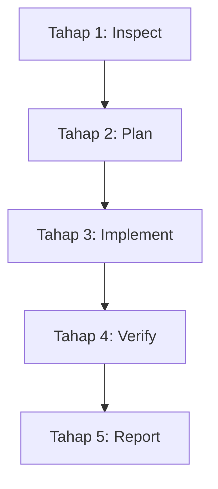

# ENGINEERING STANDARDS — LaundryDesk

## 1. Tujuan

Dokumen ini menetapkan standar rekayasa perangkat lunak (*software engineering standards*) dan pedoman penulisan kode untuk proyek **LaundryDesk (RAP Laundry)**. Tujuannya adalah memastikan seluruh kode yang dihasilkan memiliki kualitas setara standar *Senior Software Engineer & Laravel 12 Technical Lead*: ringkas, jelas, konsisten, terstruktur, aman, mudah dirawat (*maintainable*), tahan uji (*testable*), serta meminimalkan potensi cacat sistem (*zero regression & minimal bugs*).

Setiap implementasi wajib mengutamakan prinsip:
**Correctness > Security > Financial Integrity > Maintainability > Readability > Aesthetics**.

### Prinsip Utama Rekayasa:
1. **Write code that is easy to understand, not merely easy to write.** Kode dibaca jauh lebih sering daripada ditulis.
2. **KISS & YAGNI:** *Keep It Simple, Stupid* dan *You Aren't Gonna Need It*. Hindari *over-engineering* dan abstraksi yang belum terbukti manfaatnya.
3. **Single Responsibility Principle (SRP):** Satu class atau method hanya memiliki satu alasan untuk berubah.
4. **Never trust user input:** Validasi di sisi server secara ketat dan gagalkan sedini mungkin (*fail fast & fail safely*).
5. **DRY with pragmatic boundaries:** Jangan menduplikasi logika bisnis. Namun, jangan memaksakan abstraksi jika dua hal hanya kebetulan mirip secara struktural tetapi berbeda domain.
6. **Financial Data is Sacred:** Jangan menggunakan tipe data floating point untuk nilai moneter atau kuantitas berat. Selalu gunakan `DECIMAL` dan hitung ulang di server.
7. **Offline-First Resilience:** Fitur inti aplikasi wajib beroperasi penuh tanpa jaringan internet. Tidak boleh ada ketergantungan pada CDN, API eksternal, atau font pihak ketiga.
8. **Verify Before Declaring Done:** Jangan pernah mengklaim suatu fitur berfungsi atau pengujian lolos jika belum benar-benar dijalankan dan diverifikasi di lingkungan lokal.

---

## 2. Konteks Proyek dan Batasan Lingkungan

- **Nama Proyek:** LaundryDesk (RAP Laundry)
- **Jenis Sistem:** Website pengelolaan operasional usaha laundry pakaian offline untuk skala kecil hingga menengah.
- **Framework Utama:** Laravel 12 (PHP 8.2+ kompatibel).
- **Bahasa & Templating:** PHP dengan Laravel Blade, JavaScript murni (*Vanilla JS*), HTML5 semantik, dan CSS3 murni (*Vanilla CSS* / utilitas lokal terkompilasi).
- **Database:** MySQL / MariaDB lokal, dikelola melalui phpMyAdmin sebagai alat administrasi.
- **Gaya Desain (UI/UX):** Glassmorphism modern elegan dengan palet biru dan putih (`#2563EB`, `#1D4ED8`, `#DBEAFE`, `#F4F8FF`, `#172554`), kontras tinggi untuk keterbacaan kasir harian.
- **Arsitektur:** Laravel MVC bersih diperkuat dengan Service Layer, Form Request, Policy/Middleware, serta PHP Enum untuk status domain.
- **Mode Operasional:** **100% Offline-First**. Seluruh aset frontend (CSS, JS, Font, Ikon SVG) wajib tersimpan secara lokal di direktori `public/`.
- **Lokalisasi:**
  - Bahasa Antarmuka & Validasi: Bahasa Indonesia.
  - Zona Waktu: `Asia/Jakarta` (WIB).
  - Format Tanggal: `dd-mm-yyyy` (waktu 24 jam).
  - Format Mata Uang: Rupiah (contoh: `Rp25.000`).
  - Format Nomor Transaksi: `LD-YYYYMMDD-0001` (terurut, unik, aman dari duplikasi konkurensi).

> [!IMPORTANT]
> Dilarang menambahkan framework CSS/JS berat baru, package pihak ketiga, CDN eksternal, atau API cloud tanpa justifikasi teknis formal dan persetujuan.

---

## 3. Standar Penulisan Kode dan Konvensi

### 3.1 Ringkas, Jelas, dan Padat
Setiap baris kode harus memiliki alasan keberadaan yang nyata. Hindari kode berulang (*boilerplate* tak bermakna), komentar basa-basi, kondisi bersarang yang dalam (*deep nested conditions*), dan pola *wrapper* yang berlebihan.

**Hindari:**
- Method controller lebih dari 30–40 baris dengan banyak tanggung jawab.
- Nested `if-else` lebih dari 2 tingkat kedalaman (gunakan *early return / guard clauses*).
- Variabel generik tanpa arti (`$data`, `$val`, `$temp`, `$b`, `$arr`).
- *Magic numbers* dan *magic strings* (misalnya: status cucian ditulis sebagai string lepas `'dicuci'` berulang kali alih-alih `LaundryStatus::Dicuci->value`).
- Duplikasi kalkulasi diskon, subtotal, atau biaya tambahan di banyak file.
- Penggunaan ternary bertingkat (*nested ternary*).

**Utamakan:**
- **Guard Clauses & Early Return:** Validasi syarat kondisi di awal method dan segera keluar jika tidak terpenuhi.
- **Nama Variabel Deskriptif & Lugas:** Menjelaskan domain bisnis laundry secara eksplisit.
- **PHP Enums:** Gunakan *backed enum* untuk seluruh status (cucian, pembayaran, peran pengguna).
- **Type Hinting & Return Types:** Selalu definisikan tipe parameter dan return type secara eksplisit pada method PHP.

```php
// ✅ Disarankan: Bersih, ekspresif, guard clause, type hinting
public function updateLaundryStatus(Order $order, LaundryStatus $newStatus, User $operator): void
{
    if ($order->laundry_status === $newStatus) {
        return;
    }

    if (! $order->canTransitionTo($newStatus)) {
        throw new InvalidStatusTransitionException("Transisi status dari {$order->laundry_status->label()} ke {$newStatus->label()} tidak diizinkan.");
    }

    $order->changeStatus($newStatus, $operator);
}

// ❌ Dilarang: Nested berlebihan, variabel tidak bermakna, tanpa tipe data
public function updateStatus($o, $s, $u)
{
    if ($o) {
        if ($s) {
            if ($o->laundry_status != $s) {
                $o->laundry_status = $s;
                $o->save();
            }
        }
    }
}
```

### 3.2 Konvensi Penamaan (Naming Conventions)
- **Class, Interface, Trait, Enum:** `PascalCase` (contoh: `OrderService`, `PaymentMethod`, `CustomerPolicy`, `LaundryStatus`).
- **Method & Variabel PHP:** `camelCase` (contoh: `calculateRemainingBalance()`, `$customerPhone`, `$serviceSnapshot`).
- **Konstanta:** `UPPER_SNAKE_CASE` (contoh: `MAX_DISCOUNT_PERCENTAGE`, `INVOICE_PREFIX`).
- **Tabel Database:** `snake_case`, jamak/plural (contoh: `customers`, `orders`, `order_items`, `payments`, `activity_logs`).
- **Kolom Database:** `snake_case` (contoh: `order_number`, `billing_unit_snapshot`, `total_amount`, `is_active`).
- **Foreign Key:** `singular_table_id` (contoh: `customer_id`, `order_id`, `created_by`).
- **Route Name:** Pola terstruktur bertingkat (contoh: `orders.index`, `orders.create`, `orders.store`, `payments.void`).
- **Blade Views & Components:** `kebab-case` (contoh: `resources/views/orders/create.blade.php`, `resources/views/components/badge-status.blade.php`).
- **CSS Class:** `kebab-case` atau utilitas terstruktur (contoh: `glass-card`, `status-badge-success`, `btn-primary`).
- **JavaScript:** `camelCase` untuk fungsi/variabel, `PascalCase` untuk modul/class.

### 3.3 Formatting dan Kebersihan Kode
- Patuhi standar **PSR-12** dan konvensi resmi **Laravel Pint**.
- Gunakan indentasi 4 spasi untuk PHP dan 2 atau 4 spasi konsisten untuk Blade/HTML/JS/CSS.
- Hapus semua *unused imports* (`use`), variabel mati, dan kode *commented-out* sebelum melakukan commit.
- Dilarang meninggalkan fungsi debugging seperti `dd()`, `dump()`, `ray()`, `var_dump()`, atau `console.log()` pada kode yang disubmit.

---

## 4. Arsitektur Laravel 12

LaundryDesk mengadopsi arsitektur Laravel MVC yang bersih dan pragmatis, diperkuat dengan pemisahan tanggung jawab yang tegas:

```
app/
├── Enums/               # Backed Enums (LaundryStatus, PaymentStatus, UserRole, BillingUnit)
├── Http/
│   ├── Controllers/     # Handle HTTP requests, responses, and redirection
│   ├── Requests/        # Form Request Classes untuk validasi input
│   └── Middleware/      # Pemeriksaan autentikasi, status aktif, dan role
├── Models/              # Eloquent Models, Relationships, Scopes, Casts
├── Policies/            # Kebijakan otorisasi hak akses (Admin vs Kasir)
└── Services/            # Business Logic terpusat (OrderService, PaymentService, PricingService)
```

### 4.1 Controller
Controller hanya bertindak sebagai orkestrator HTTP.
- **Tugas Controller:** Menerima HTTP Request terverifikasi, memanggil Service atau Model, menyiapkan data respon, dan mengembalikan View atau Redirect.
- **Larangan Controller:** Dilarang meletakkan query SQL/Eloquent bertingkat yang panjang, kalkulasi diskon/pajak matematis, atau manipulasi database multi-tabel langsung di dalam controller.

```php
public function store(StoreOrderRequest $request, OrderService $orderService): RedirectResponse
{
    $order = $orderService->createOrder(
        data: $request->validated(),
        operator: $request->user()
    );

    return redirect()
        ->route('orders.show', $order)
        ->with('success', "Pesanan {$order->order_number} berhasil dibuat.");
}
```

### 4.2 Model
Model merepresentasikan entitas data dan relasi bisnis.
- Selalu tentukan atribut `$fillable` secara eksplisit dan sadar (hindari `$guarded = []` pada model utama).
- Definisikan tipe data menggunakan `$casts` modern Laravel (termasuk casting ke PHP Enum dan `decimal:2`).
- Definisikan seluruh relasi Eloquent (`belongsTo`, `hasMany`) dengan type-hinting lengkap.
- Terapkan Query Scope untuk filter yang berulang (misal: `scopeToday()`, `scopeUnpaid()`).
- Simpan snapshot layanan pada pesanan agar perubahan harga master tidak merusak data historis.

```php
class OrderItem extends Model
{
    protected $fillable = [
        'order_id',
        'service_id',
        'service_name_snapshot',
        'billing_unit_snapshot',
        'quantity',
        'unit_price',
        'subtotal',
        'notes',
    ];

    protected function casts(): array
    {
        return [
            'quantity' => 'decimal:2',
            'unit_price' => 'decimal:2',
            'subtotal' => 'decimal:2',
            'billing_unit_snapshot' => BillingUnit::class,
        ];
    }

    public function order(): BelongsTo
    {
        return $this->belongsTo(Order::class);
    }

    public function service(): BelongsTo
    {
        return $this->belongsTo(Service::class);
    }
}
```

### 4.3 Service Layer
Gunakan Service Class ketika suatu operasi mencakup business logic lintas entitas atau koordinasi proses yang kompleks:
- `OrderService`: Pembuatan pesanan, kalkulasi ulang item, pembuatan nomor transaksi unik, penanganan pembatalan pesanan.
- `PaymentService`: Pencatatan uang masuk, kalkulasi sisa tagihan, pembatalan/void pembayaran dengan jejak audit, pembaruan status pembayaran.
- `PricingService`: Validasi tarif berdasarkan kuantitas, kalkulasi diskon, dan biaya tambahan.
- `InvoiceService`: Penyusunan data cetak nota ramah printer offline.

### 4.4 Form Request
Semua validasi form wajib dipusatkan di kelas `FormRequest` khusus (`StoreOrderRequest`, `RecordPaymentRequest`, dll.).
- Mengelompokkan aturan validasi domain dan sanitasi input.
- Menyediakan pesan error berbahasa Indonesia yang jelas, sopan, dan informatif.
- Memastikan hak akses awal pada method `authorize()`.

### 4.5 PHP Enums
Gunakan PHP Backed Enums untuk standardisasi status dan unit penagihan:
- `LaundryStatus`: `Diterima`, `MenungguProses`, `Dicuci`, `Dikeringkan`, `Disetrika`, `SiapDiambil`, `Selesai`, `Dibatalkan`.
- `PaymentStatus`: `BelumDibayar`, `DibayarSebagian`, `Lunas`.
- `PaymentMethod`: `Tunai`, `TransferBank`, `QrisManual`, `Lainnya`.
- `BillingUnit`: `Kg`, `Item`, `Paket`.
- `UserRole`: `Admin`, `Kasir`.

---

## 5. Standar Database, Integritas Data & Finansial

Database adalah **satu-satunya sumber kebenaran (*single source of truth*)**. Karena LaundryDesk menangani transaksi uang tunai riil, integritas data finansial mutlak dijaga.

### 5.1 Skema dan Migration
- Semua modifikasi skema wajib melalui Laravel migration. Tidak diperkenankan mengubah kolom langsung di phpMyAdmin tanpa membuat file migrasi padanannya.
- Tentukan foreign key constraint dengan aturan *cascade/null on delete* yang aman. Data transaksi (`orders`, `order_items`, `payments`) tidak boleh dihapus secara *cascade* jika pelanggan atau layanan dinonaktifkan.
- Gunakan index pada kolom yang sering dicari: `order_number`, `customer_code`, `phone`, `laundry_status`, `payment_status`, dan `payment_date`.

### 5.2 Aturan Ketat Integritas Finansial
1. **Tipe Data Moneter:** Wajib menggunakan `DECIMAL(12, 2)` atau `DECIMAL(14, 2)` untuk uang dan `DECIMAL(8, 2)` untuk kuantitas berat. **Dilarang keras memakai `FLOAT` atau `DOUBLE`**.
2. **Server-Side Re-calculation:** Nilai subtotal, diskon, biaya tambahan, total tagihan, dan sisa tagihan **wajib dihitung ulang di server**. Data harga total yang dikirim dari browser tidak boleh dipercaya mentah-mentah.
3. **Database Transactions (`DB::transaction`):** Operasi yang melibatkan penyimpanan order beserta itemnya, atau pencatatan pembayaran beserta mutasi saldo wajib dibungkus dalam transaksi database untuk menjamin atomisitas (ACID).
4. **Mekanisme Locking:** Gunakan `lockForUpdate()` saat menghasilkan nomor urut transaksi harian (`LD-YYYYMMDD-XXXX`) atau saat memproses pembayaran konkuren guna menghindari kondisi balapan (*race condition*).
5. **Prinsip Audit Pembayaran (Anti-Silent Edit):**
   - Pembayaran historis yang sudah tersimpan **tidak boleh diedit nominalnya secara diam-diam**.
   - Jika terjadi kesalahan input kasir, pembayaran harus dibatalkan melalui mekanisme **Void Pembayaran** dengan mencatat aktor, waktu, dan alasan pembatalan.
   - Sisa tagihan dihitung dari:  
     $$\text{Sisa Tagihan} = \text{Total Tagihan} - \sum(\text{Pembayaran Valid})$$

### 5.3 Kebijakan Penghapusan Data (Data Retention)
- Master data pelanggan dan layanan menggunakan soft delete atau flag `is_active` boolean.
- Data transaksi (`orders`, `payments`, `order_status_histories`) tidak boleh dihapus secara fisik (*hard delete*). Jika terjadi pembatalan, ubah status pesanan menjadi `Dibatalkan` dan catat alasan serta petugas yang bertanggung jawab.

---

## 6. Keamanan Aplikasi & Otorisasi

Sistem offline bukan alasan untuk mengabaikan keamanan (*offline does not mean unsecure*). Seluruh standar keamanan web modern tetap berlaku penuh:

### 6.1 Autentikasi dan Manajemen Sesi
- Login menggunakan kredensial aman (username/email dan password).
- Password di-hash menggunakan algoritma default Laravel yang kuat (`bcrypt` / `argon2id`).
- Lakukan regenerasi session ID saat login (`$request->session()->regenerate()`) untuk mencegah serangan *session fixation*.
- Invalidasi sesi dan regenerasi token CSRF saat logout.
- Karena sistem berjalan offline tanpa email server lokal, tidak ada alur lupa password publik. Sediakan perintah Artisan terdokumentasi (misalnya `php artisan laundry:reset-admin`) untuk pemulihan akun admin darurat.

### 6.2 Otorisasi Berbasis Peran (RBAC)
Pemisahan hak akses antara **Admin (Pemilik)** dan **Kasir (Staf)** ditegakkan di sisi server melalui Laravel Middleware dan Policy:
- **Admin:** Memiliki akses penuh terhadap dashboard, konfigurasi usaha, master layanan & harga, manajemen user/kasir, pembatalan transaksi, void pembayaran, ekspor seluruh laporan keuangan, dan pemberian diskon hingga 100% (subtotal).
- **Kasir:** Terbatas pada operasional harian: registrasi pelanggan, pembuatan pesanan laundry, pengkinian status cucian harian, pencatatan pembayaran tunai/manual, dan cetak nota transaksi. Kasir dilarang mengakses manajemen pengguna, pengaturan sistem, atau manipulasi master tarif.
- **Batasan Izin Diskon Kasir:** Diskon oleh kasir dibatasi oleh pengaturan usaha `cashier_max_discount_percent` (default 20%). Diskon melebihi batas tersebut ditolak oleh validasi server dan memerlukan wewenang Admin.
- **Prinsip Validasi Server:** Menyembunyikan tombol di Blade hanyalah kenyamanan UI. Otorisasi sesungguhnya wajib divalidasi pada Form Request atau Policy di server.

### 6.3 Pencegahan Kerentanan Klasik
- **CSRF Protection:** Seluruh form HTTP (POST, PUT, PATCH, DELETE) wajib menyertakan `@csrf`.
- **SQL Injection:** Wajib menggunakan Eloquent ORM atau parameterized query builder. Dilarang menggabungkan string mentah input pengguna ke dalam klausa SQL.
- **Cross-Site Scripting (XSS):** Selalu gunakan escaping Blade default `{{ $variable }}`. Penggunaan raw output `{!! $variable !!}` dilarang keras kecuali untuk output SVG lokal yang sudah terverifikasi statis.
- **File Upload Security:** Upload logo usaha pada pengaturan bisnis wajib divalidasi ketat: batasan ekstensi (PNG/JPG/SVG), ukuran file maksimal (maks 1MB), sanitasi nama file, dan penyimpanan aman di storage lokal publik.

---

## 7. Business Logic LaundryDesk

### 7.1 Alur Transaksi dan Pemesanan
1. Setiap pesanan memiliki identitas unik berupa nomor transaksi berurutan: `LD-YYYYMMDD-0001`.
2. Pesanan terikat pada satu pelanggan yang valid (pelanggan lama atau dibuat seketika saat pemesanan). Penambahan pelanggan baru dari form pesanan didukung via modal in-place AJAX lokal sehingga baris pesanan yang telah diinput tidak hilang.
3. Pesanan dapat memiliki satu atau lebih item layanan dinamis.
4. **Snapshot Tarif & Layanan:** Saat item pesanan disimpan ke `order_items`, sistem wajib mencatat snapshot nama layanan, satuan, dan tarif per unit pada saat transaksi dibuat. Perubahan harga master layanan di kemudian hari tidak boleh mengubah kalkulasi pada nota pesanan terdahulu.
5. Berat cucian berbasis kilogram wajib mendukung bilangan desimal (misal: 2,5 kg atau 3,75 kg) dengan presisi 2 angka di belakang koma. Sistem otomatis menormalisasi pemisah koma (`,`) menjadi titik (`.`). Kuantitas non-kilogram wajib bilangan bulat positif.
6. Kuantitas pada setiap baris item wajib bernilai lebih besar dari nol (`quantity > 0`).
7. **Kalkulasi Estimasi Waktu Selesai:** Estimasi selesai dihitung otomatis berdasarkan durasi terlama dari layanan yang dipilih (`received_at + max(service.estimated_hours)`) atau konfigurasi default usaha, serta dapat disesuaikan manual oleh kasir via input atau tombol pintas cepat (+1 Hari, +2 Hari, +3 Hari).
8. **Diskon & Biaya Tambahan:** Diskon dikontrol oleh batas izin peran (`0 ≤ discount_amount ≤ subtotal`), sedangkan biaya tambahan non-negatif (`extra_charge ≥ 0`) dapat diisi oleh kasir dan admin untuk kebutuhan express atau antar-jemput.

### 7.2 Pemisahan Status Cucian vs Status Pembayaran
Status cucian dan status pembayaran adalah dua domain independen yang tidak boleh disatukan:
- **Status Cucian (Laundry Status):**
  1. `Diterima` — Pesanan baru dicatat kasir.
  2. `Menunggu Proses` — Masuk antrean operasional.
  3. `Dicuci` — Dalam tabung cuci.
  4. `Dikeringkan` — Proses pengeringan.
  5. `Disetrika` — Proses penyetrikaan (opsional jika layanan menyertakan setrika).
  6. `Siap Diambil` — Cucian selesai dikemas dan siap diserahkan.
  7. `Selesai/Diambil` — Pelanggan telah mengambil pakaian.
  8. `Dibatalkan` — Pesanan dibatalkan secara sah.
- **Status Pembayaran (Payment Status):**
  1. `Belum Dibayar` — Total pembayaran valid = Rp0.
  2. `Dibayar Sebagian` — Rp0 < Total pembayaran valid < Total tagihan.
  3. `Lunas` — Total pembayaran valid $\ge$ Total tagihan.
- **Aturan Interaksi Status:**
  - Pakaian berstatus `Siap Diambil` belum tentu `Lunas`. Kasir dapat menahan penyerahan jika belum lunas, namun sistem tetap harus mencatat status fisik cucian secara akurat.
  - Pakaian berstatus `Lunas` belum tentu `Selesai/Diambil`.
  - Setiap transisi status cucian wajib mencatat riwayat kronologis di tabel `order_status_histories` (status awal, status akhir, waktu, operator, dan catatan).

### 7.3 Logika Pembayaran Manual
- Transaksi pembayaran offline dicatat saat kasir menerima fisik uang tunai, bukti transfer lokal, atau bukti QRIS manual.
- Sistem mendukung pembayaran uang muka (DP), pelunasan bertahap, maupun pembayaran lunas di awal.
- Pembayaran tidak boleh melebihi sisa tagihan yang harus dibayar, kecuali jika sistem secara eksplisit menangani kembalian uang tunai.
- Pembatalan pembayaran (void) hanya dapat dilakukan oleh role Admin atau izin khusus, dan wajib mencatat alasan pembatalan pada audit log.

### 7.4 Nota dan Dokumen Fisik
- Sistem wajib menyediakan tampilan cetak nota kasir yang dioptimalkan menggunakan CSS `@media print`.
- Saat dicetak, seluruh komponen navigasi (sidebar, topbar, tombol aksi, footer) wajib disembunyikan.
- Nota wajib memuat: identitas usaha, nomor transaksi unik, tanggal masuk & estimasi selesai, data pelanggan, rincian item layanan (kuantitas, tarif snapshot, subtotal), diskon & biaya tambahan, total tagihan, pembayaran yang sudah masuk, sisa tagihan, nama kasir penerima, serta klausul syarat & ketentuan pengambilan pakaian.

---

## 8. Frontend, Blade & Glassmorphism Design System

Antarmuka LaundryDesk mengusung prinsip **Glassmorphism Biru-Putih** yang bersih, modern, dan tidak melelahkan mata staf kasir yang bekerja sepanjang hari.

### 8.1 Prinsip Desain Glassmorphism & Aksesibilitas
- **Warna Pokok (Design Tokens):**
  - Primary Blue: `#2563EB`
  - Deep Navy Blue: `#1D4ED8` / `#1E40AF`
  - Soft Ice Blue: `#DBEAFE`
  - Surface Background: `#F4F8FF` (lembut, tidak silau)
  - Glass Card Background: `rgba(255, 255, 255, 0.78)` dengan border halus `rgba(148, 163, 184, 0.25)`
  - Primary Text: `#172554` (kontras tajam, memenuhi standar WCAG AA)
  - Secondary Text: `#475569`
  - Semantic Status: Hijau untuk sukses/lunas (`#16A34A`), Amber untuk proses/sebagian (`#D97706`), Merah untuk batal/belum bayar (`#DC2626`).
- **Keterbacaan Di Atas Estetika:** Efek blur (`backdrop-filter: blur(12px)`) hanya digunakan sebagai pemanis estetika latar kartu. Elemen teks, input form, dan baris tabel wajib memiliki kontras solid yang tajam dan mudah dibaca.
- **Fallback Non-Blur:** Sediakan CSS fallback solid white (`#FFFFFF`) jika browser lama tidak mendukung `backdrop-filter`.
- **Micro-Interactions:** Sediakan transisi halus saat hover tombol dan fokus input (`outline` biru jelas untuk aksesibilitas keyboard).
- **Reduced Motion:** Hormati pengaturan pengguna melalui media query `@media (prefers-reduced-motion: reduce)`.

### 8.2 Struktur Templating Blade
- **Master Layout (`layouts/app.blade.php`):** Menyediakan struktur dasar HTML5, meta tags, penampung notifikasi toast/alert, sidebar navigasi, dan topbar.
- **Partials:** Pisahkan bagian modular seperti `partials/sidebar.blade.php`, `partials/topbar.blade.php`, dan `partials/alerts.blade.php`.
- **Reusable Components:**
  - `<x-badge-status>`: Render badge status cucian dan pembayaran dengan warna dan label yang seragam.
  - `<x-stat-card>`: Kartu ringkasan metrik dashboard glassmorphism.
  - `<x-button>` & `<x-input>`: Komponen form dengan state fokus dan error yang konsisten.
- Dilarang menulis kueri database atau business logic perhitungan di dalam file Blade template.

### 8.3 Kemandirian Aset Frontend (100% Offline)
- **Zero External Dependencies:** Dilarang menggunakan `<link>` atau `<script>` yang mengarah ke URL eksternal (CDNjs, unpkg, Google Fonts, jsDelivr, FontAwesome CDN, dsb.).
- **Font Lokal:** Gunakan system font stack modern (`system-ui, -apple-system, "Segoe UI", Roboto, sans-serif`) atau font lokal yang tersimpan di direktori proyek.
- **Ikon SVG Lokal:** Seluruh ikon navigasi dan aksi wajib berupa inline SVG atau file SVG lokal yang tersimpan di dalam proyek.
- **Hasil Build Siap Pakai:** File CSS dan JavaScript hasil build Vite wajib sudah terkompilasi dan tersedia langsung di `public/build/` atau `public/css/` sehingga aplikasi dapat langsung dibuka via web server lokal (Apache/XAMPP) tanpa perlu menjalankan node dev server di lingkungan kasir.

---

## 9. Penanganan Error, Exception & Logging

1. **Prinsip Fail-Safe:** Tangani error pada batas (*boundary*) yang tepat. Jangan biarkan exception teknis mentah bocor ke pengguna akhir.
2. **User-Friendly Error Messages:** Tampilkan pesan kegagalan dalam Bahasa Indonesia yang informatif dan jelas solusinya (contoh: *"Nomor transaksi ini sudah terdaftar. Silakan muat ulang halaman untuk mendapatkan nomor baru"*).
3. **Pencatatan Log Teknis:** Gunakan fungsi `Log::error()` atau `report($exception)` untuk merekam detail jejak error (*stack trace*) di storage log Laravel (`storage/logs/laravel.log`).
4. **Sanitasi Log:** Dilarang mencatat kata sandi, token otorisasi, atau data rahasia lainnya ke dalam file log.
5. **No Empty Catch Blocks:** Dilarang menggunakan blok `catch (\Exception $e) {}` yang kosong tanpa aksi penanganan atau pelaporan.
6. **Mencegah Double Submission:** Pada form pembuatan pesanan dan pembayaran, terapkan pelindung di sisi JavaScript untuk menonaktifkan tombol submit (*disable on submit*) saat proses simpan sedang berlangsung guna mencegah terjadinya input transaksi ganda.

---

## 10. Pencegahan Bug & Checklist Verifikasi Awal

Sebelum menyelesaikan atau menyerahkan fitur apapun, setiap engineer wajib menguji 12 parameter uji kritis berikut:

| No | Parameter Pemeriksaan | Pertanyaan Pengujian |
|---|---|---|
| 1 | **Validasi Input Ekstrem** | Apakah input kuantitas 0, negatif, teks acak, atau desimal berlebih ditolak dengan aman? |
| 2 | **Otorisasi Server** | Apakah staf kasir dapat membobol rute admin hanya dengan mengetik URL di address bar? |
| 3 | **Penanganan 404** | Apakah pencarian ID pelanggan atau pesanan yang tidak ada menghasilkan respon 404 yang rapi tanpa fatal error? |
| 4 | **Pencegahan Duplikasi** | Apakah mengklik tombol 'Simpan' secara cepat/ganda dapat menciptakan 2 nomor pesanan identik? |
| 5 | **Validitas Transisi** | Apakah pesanan yang dibatalkan dapat diubah statusnya menjadi selesai secara ilegal? |
| 6 | **Integritas Relasi** | Apakah menonaktifkan master layanan membuat pesanan historis menjadi error (*null reference*)? |
| 7 | **Atomisitas Transaksi** | Jika proses penyimpanan item order ke-3 gagal, apakah order header dan item 1-2 berhasil di-rollback? |
| 8 | **Kalkulasi Server** | Jika kasir mengubah harga di DevTools browser, apakah server tetap memakai harga master database? |
| 9 | **Sisa Saldo & Kembalian** | Apakah pembayaran melebihi sisa tagihan ditangani sesuai batasan aturan bisnis? |
| 10 | **Tampilan & Kontras** | Apakah teks tabel dan form tetap terbaca jelas pada layar monitor kasir tanpa efek blur yang mengaburkan? |
| 11 | **Kemandirian Offline** | Apakah seluruh halaman dan ikon tetap tampil utuh saat koneksi Wi-Fi/Internet dimatikan total? |
| 12 | **Dampak Regresi** | Apakah perubahan pada modul pembayaran merusak angka ringkasan di dashboard atau modul laporan? |

---

## 11. Testing & Verifikasi Otomatis

Proyek LaundryDesk mengadopsi automated test menggunakan **PHPUnit** atau **Pest** (sesuai konfigurasi dasar Laravel 12). Pengujian otomatis difokuskan pada alur bisnis kritis (*critical business paths*).

### 11.1 Cakupan Pengujian Wajib (Feature & Unit Tests)
1. **Autentikasi & Hak Akses (`AuthenticationTest` & `AuthorizationTest`):**
   - Kasir berhasil login dan diarahkan ke dashboard operasional.
   - Kasir ditolak (403 Forbidden) saat mencoba mengakses pengaturan bisnis atau manajemen user admin.
2. **Master Data (`CustomerTest`, `ServiceTest`):**
   - Validasi data pelanggan dan pencegahan nomor telepon ganda/invalid.
   - Perubahan harga layanan tidak mengubah harga snapshot pada transaksi lama.
3. **Kalkulasi & Pemesanan (`OrderCreationTest`):**
   - Perhitungan subtotal item, diskon, biaya tambahan, dan grand total terverifikasi benar secara matematis.
   - Kuantitas desimal (misal 2.5 kg) tersimpan dan terhitung dengan presisi desimal tepat.
   - Input kuantitas 0 atau negatif ditolak oleh validasi server.
   - Keberhasilan rollback transaksi jika terjadi kegagalan parsial saat insert item.
4. **Pembayaran & Void (`PaymentTest`):**
   - Pembayaran sebagian memperbarui sisa tagihan dan status pesanan menjadi `Dibayar Sebagian`.
   - Pembayaran genap memperbarui status pesanan menjadi `Lunas` dan sisa tagihan menjadi `0.00`.
   - Pembayaran melebihi sisa tagihan ditolak sesuai validasi.
   - Void pembayaran berhasil membatalkan mutasi dan mengembalikan status sisa tagihan dengan jejak audit.
5. **Transisi Status (`OrderStatusTransitionTest`):**
   - Transisi status cucian tercatat di kronologi riwayat tabel `order_status_histories`.
   - Transisi ilegal (misal dari `Diterima` langsung lompat ke `Selesai` tanpa proses) ditolak.

### 11.2 Verifikasi Pra-Selesai
Sebelum pekerjaan dinyatakan tuntas, jalankan perintah pengujian berikut di terminal lokal:
```bash
php artisan test
php artisan route:list
php artisan migrate:status
```
> [!NOTE]
> Jika terdapat pengujian yang gagal atau terkendala oleh lingkungan kerja lokal, catat penyebab teknis secara transparan pada dokumen laporan. Dilarang memanipulasi hasil pengujian.

---

## 12. Standar Query, Eager Loading & Performa

Meskipun LaundryDesk beroperasi di jaringan lokal, performa query database harus tetap optimal untuk mencegah kelambatan saat volume data transaksi mencapai ribuan baris:

1. **Eliminasi N+1 Problem:** Selalu gunakan *eager loading* (`with()`) ketika menampilkan data relasi pada daftar tabel atau laporan.
   ```php
   // ✅ Benar: Menggunakan eager loading
   $orders = Order::query()
       ->with(['customer', 'items', 'latestStatusHistory'])
       ->latest('received_at')
       ->paginate(15);

   // ❌ Dilarang: Menimbulkan N+1 query loop
   $orders = Order::latest()->paginate(15);
   // Di dalam Blade memanggil $order->customer->name dan $order->items->count()
   ```
2. **Pagination Wajib:** Semua tampilan daftar data (pesanan, pelanggan, histori log) wajib menggunakan pagination (`paginate()` atau `simplePaginate()`). Dilarang menggunakan `Model::all()` tanpa batasan pada tabel transaksi.
3. **Seleksi Kolom yang Relevan:** Gunakan `select()` jika tabel memiliki banyak kolom teks atau histori yang tidak diperlukan pada tampilan ringkasan tabel.
4. **Agregasi Database:** Gunakan fungsi agregat SQL (`count()`, `sum()`, `avg()`) langsung melalui Query Builder alih-alih mengambil ribuan baris Model ke memori PHP lalu menghitungnya via Collection.

---

## 13. Dokumentasi, Backup & Jejak Audit

### 13.1 Standar Komentar Kode
Komentar hanya ditulis untuk menjelaskan **"MENGAPA"** (*the intent, business rationale, or non-obvious decision*), bukan menjelaskan **"APA"** yang sudah jelas terbaca dari kode.
```php
// ✅ Komentar yang tepat: Menjelaskan alasan bisnis / proteksi konkurensi
// Gunakan database locking untuk mencegah nomor faktur ganda saat dua kasir checkout bersamaan.
$latestOrder = Order::whereDate('created_at', today())->lockForUpdate()->first();

// ❌ Komentar buruk: Mengulang apa yang sudah tertulis
// Simpan order
$order->save();
```

### 13.2 Jejak Audit Aktivitas (`ActivityLog`)
Sistem menyediakan tabel audit log untuk mencatat tindakan penting yang dilakukan oleh aktor pengguna:
- Login dan logout staf.
- Pembuatan dan pembatalan pesanan.
- Pencatatan pembayaran dan void pembayaran.
- Perubahan tarif master layanan.
- Perubahan parameter pengaturan usaha.
- Kolom audit mencatat: `user_id`, `action`, `subject_type`, `subject_id`, `description`, `metadata` (JSON), dan `created_at`.

### 13.3 Protokol Backup & Restore
Sesuai amanat PRD dan TASK.md, prosedur backup lokal wajib tersedia:
1. **Pre-Implementation Backup:** Sebelum melakukan perubahan struktural atau modifikasi besar pada file proyek yang sudah ada, buat salinan cadangan di folder `backups/pre-implementation-YYYYMMDD-HHmm/`.
2. **Database Backup:** Dokumentasikan cara ekspor database via phpMyAdmin maupun perintah `mysqldump` lokal.
3. **Kerahasiaan Kredensial:** Dilarang menyertakan file `.env` asli yang berisi kata sandi ke dalam repositori publik. Selalu sediakan `.env.example` yang bersih.

---

## 14. Standar Perubahan Kode & Kontrol Versi

1. **Pemeriksaan Kode Eksisting:** Sebelum mengubah file, periksa dan pahami implementasi yang sudah ada. Pertahankan konvensi yang sudah disepakati.
2. **Scope of Change Terukur:** Lakukan perubahan hanya pada file yang relevan dengan tugas. Jangan melakukan *refactoring* liar pada modul lain yang sedang stabil.
3. **Tidak Menghapus Fitur Tanpa Alasan:** Dilarang menghapus fitur, validasi, atau penanganan error yang sudah ada demi mempersingkat kode.
4. **Kompatibilitas Versi:** Pastikan seluruh sintaks kompatibel dengan PHP 8.2+ dan Laravel 12.
5. **Git Commit Standards:** Gunakan pesan commit yang deskriptif dan terstruktur:
   - `feat: implement order creation with item snapshotting`
   - `fix: resolve remaining balance calculation on void payment`
   - `refactor: extract pricing logic into PricingService`
   - `test: add feature tests for cashier role authorization`

---

## 15. Workflow Wajib AI Agent

Setiap sesi pengembangan atau penyelesaian task oleh AI Agent (Gemini 3.8 Flash High) wajib mematuhi 5 tahapan kerja berurutan berikut tanpa jalan pintas:



### Tahap 1 — Inspect (Pemeriksaan & Audit)
- Periksa struktur direktori proyek dan identifikasi file yang sudah ada.
- Baca file rujukan utama: `project/PRD.md`, `project/TASK.md`, dan `project/ENGINEERING_STANDARDS.md`.
- Periksa konfigurasi dependensi di `composer.json` dan `package.json`.
- Jangan berasumsi file sudah ada sebelum benar-benar memeriksanya.

### Tahap 2 — Plan (Perencanaan & Mitigasi Risiko)
- Uraikan dengan jelas masalah bisnis atau task yang akan diselesaikan.
- Tentukan daftar file yang akan dibuat atau diubah beserta dampaknya terhadap database dan modul lain.
- Identifikasi skenario kegagalan (*edge cases*) dan siapkan rencana pengujian.
- Untuk perubahan skala besar atau destruktif, pastikan tahapan backup telah disiapkan.

### Tahap 3 — Implement (Penerapan Solusi)
- Terapkan solusi terkecil yang menyelesaikan masalah secara tuntas (*clean, minimal, secure*).
- Patuhi standar arsitektur: gunakan Form Request, Service Layer, Enums, dan DB Transaction jika diperlukan.
- Terapkan validasi server-side dan otorisasi role secara tegas.
- Dilarang meninggalkan kode *placeholder* (*mock data* atau *"implementasi nanti"*).

### Tahap 4 — Verify (Pengujian & Validasi)
- Jalankan pemeriksaan sintaks PHP dan automated test yang relevan (`php artisan test`).
- Verifikasi rute aplikasi (`php artisan route:list`) dan status migrasi.
- Uji skenario sukses, skenario gagal (input tidak valid/negatif), dan batasan otorisasi kasir vs admin.
- Pastikan tidak ada dependensi eksternal/CDN yang bocor ke dalam view.

### Tahap 5 — Report (Pelaporan Transparan)
- Sajikan ringkasan perubahan secara jujur dan transparan.
- Rinci daftar file yang dibuat atau dimodifikasi.
- Paparkan hasil pengujian riil (lulus, gagal, atau alasan jika belum dapat dijalankan di lingkungan saat ini).
- Laporkan sisa batasan sistem (*known limitations*) dan langkah selanjutnya yang diperlukan.

---

## 16. Definition of Done (DoD)

Sebuah fitur atau task dalam LaundryDesk hanya boleh ditandai selesai (`[x]`) dalam `project/TASK.md` apabila memenuhi seluruh kriteria berikut:

- [ ] **Kebutuhan Fungsional Terpenuhi:** Fitur berjalan sesuai spesifikasi di `project/PRD.md`.
- [ ] **Validasi Server-Side Aktif:** Form Request memvalidasi tipe data, batas minimal/maksimal, dan keberadaan relasi.
- [ ] **Otorisasi Server-Side Ditegakkan:** Route dan aksi sensitif dilindungi middleware/policy sesuai role (Admin vs Kasir).
- [ ] **Integritas Database Terjaga:** Menggunakan tipe `DECIMAL` untuk uang, DB Transaction untuk operasi multi-tabel, dan snapshot data pada item pesanan.
- [ ] **Offline-Ready:** Tidak ada request ke CDN, Google Fonts, atau API pihak ketiga. Aset tersimpan lokal di `public/`.
- [ ] **UI Glassmorphism Berkualitas:** Tampilan responsif, kontras teks terbaca jelas, state hover/fokus/error tersedia, dan ramah cetak (`@media print`).
- [ ] **Penanganan Error Bersih:** Pesan error berbahasa Indonesia ramah pengguna, tanpa kebocoran detail teknis atau blok `catch` kosong.
- [ ] **Bebas Kode Debugging:** Tidak ada `dd()`, `dump()`, atau `console.log()` sementara yang tertinggal.
- [ ] **Automated Test Tersedia & Terverifikasi:** Test relevan berhasil dijalankan, atau keterbatasan lingkungan dicatat secara eksplisit.
- [ ] **Dokumentasi Terbarui:** File panduan atau checklist tugas di `project/TASK.md` diperbarui sesuai progres aktual.

---

## 17. Instruksi Final untuk AI Agent

Saat bertindak sebagai **Senior Software Engineer, System Analyst, UI/UX Designer, Laravel 12 Developer, dan QA Engineer** untuk LaundryDesk:

1. **Jadilah Senior Engineer yang Bertanggung Jawab:** Prioritaskan ketepatan kalkulasi uang, keutuhan database, alur operasional kasir harian, dan keamanan aplikasi di atas sekadar kecepatan menyelesaikan kode.
2. **Kembangkan dengan Pola Sederhana dan Nyata:** Bangun aplikasi yang berfungsi nyata, bukan sekadar mockup atau halaman statis. Hindari kompleksitas berlebihan yang sulit dirawat oleh pengembang berikutnya.
3. **Jaga Konsistensi Terminologi Domain:** Gunakan penamaan bahasa Indonesia yang natural untuk antarmuka kasir dan penamaan kode standar Laravel berbahasa Inggris yang ekspresif.
4. **Kejujuran Teknis:** Jika ada fitur yang belum teruji atau belum selesai, sampaikan secara terbuka. Jangan pernah mengklaim pekerjaan sudah selesai jika belum diverifikasi.

---
*Dokumen ini merupakan standar rekayasa resmi proyek LaundryDesk dan wajib diacu oleh seluruh pengembang serta AI Agent selama siklus hidup pengembangan sistem.*
